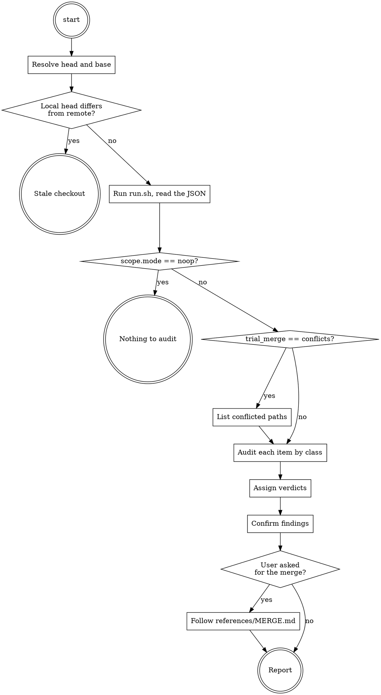

# Shopware Base Adoption

Find where the base's new gates, generated-artifact formats, dependency constraints, guidelines and helpers apply to the branch's own files.
Report only; change code only when the user asks for the merge or for a fix.
Apply the rubric in `.github/aw/shared/sw-base-adoption-policy.md` throughout.

## Workflow

### Resolve head and base

- Head: the checked-out branch unless the user names another.
- Base: the user's value, else the base branch of the head's open pull request (`gh pr view --json baseRefName`), else the repository default branch.
- Run `git fetch origin <head> <base>`.

### Stale checkout

When `git rev-parse <head>` differs from `git rev-parse origin/<head>`, stop and tell the user the local head is not the remote head.

### Run run.sh, read the JSON

Run `.agents/skills/sw-base-adoption/scripts/run.sh --base origin/<base>`.
Add `--head <ref>` for a head other than `HEAD`, `--merge <sha>` to audit that merge commit, `--since <sha>` to start the range at that ancestor of the range end, and `--out <dir>` to write into that directory instead of a temporary one.
Read the `base-adoption-input.json` whose path it prints, using these keys:

- `scope`: `mode` (`pending`, `merge`, `last-merge`, `noop`), `head`, `base`, `merge`, `range_from`, `range_to`, `commit_count`, `owned_count`, `trial_merge`; `conflicts`; `owned_files`.
- `items[]`: `id`, `class`, `commit` (the newest commit of the range that changed the item's path; for a dependency item the newest commit that changed the manifest), `commits` (every commit of the range that produced it, newest first), `path`, `detail`, `rank`, `before_tokens`, `candidates`, `generated_owned`.
- `before_tokens[]`: `token`, `sites`, `base_before_hits`, `base_after_hits`, `owned_hits`, `owned_symbol_hits`.
- `candidates[]`: `token`, `path`, `line`, `text`.
- `gate_plan[]`: `gate_id`, `command`, `extensions`.

### Nothing to audit

Report `scope.head`, `scope.base` and the mode, and stop.

### List conflicted paths

Put every path of `conflicts` into the report, then continue.

### Audit each item by class

Audit only paths in `owned_files`.
When `scope.mode` is `pending`, do not run gates or generators: the head's tree does not hold the base's gate configuration and generators yet.
Give each **gate** and **generated-artifact** item the verdict `cannot_determine` with the reason "run after the merge", unless the user asked for the merge.

**gate** (`detail` is the `gate_id`):
Read the item's diff in every commit of `commits` and list each rule it adds or tightens.
Search the gate's exemptions at the head (baseline files, suppression files, inline ignore and disable comments) for entries that apply such a rule to an owned file.
Each entry that the base at `range_to` does not have is an `adoption` finding.
When the user asked for the merge, also run the `command` of the matching `gate_plan` entry after the merge under the repository's tooling rules.
Each error in an owned file with one of its `extensions` is a `required-for-green` finding.
For `detail` `unmapped`, state which owned files the changed configuration reaches.

**generated-artifact** (`detail` is the generator command, `generated_owned` the owned outputs):
Run the generator.
An owned output that changes is a `required-for-green` finding.
Discard the regenerated files unless the user asked for the merge or the fix.

**dependency** (`path` is the manifest, `detail` reads `<package> <before> -> <after>`):
Check that the branch's own manifests and the local install state carry the new constraint.
Name a stale lock file or install state.

**guideline**: read the item's diff in every commit of `commits`, extract each new rule for authors, and check the owned files in that domain against it.

**reusable-surface** (`detail` is the new symbol, `rank` the number of files the base migrated to it):
For each candidate, read the migrated call sites in `commit` and the candidate line, and decide whether the candidate still has the earlier form.
An item with `rank` 0 or no `candidates` gets one report line, no investigation.

**bc-convention** and **migration-tooling**: read the item's diff in every commit of `commits` and state whether owned files fall in its domain.

### Assign verdicts

Give every item a verdict and every finding a class as the policy defines.

### Confirm findings

Have every finding checked by a reader that did not produce it, instructed to refute it against each condition of the policy's criterion: a subagent where the runtime offers one, else a second pass from the files only.
Report a finding that is not confirmed as `cannot_determine`.

### Follow references/MERGE.md

Load `references/MERGE.md` and follow it.

### Report

Emit the report in the format the policy defines, as the final message.
