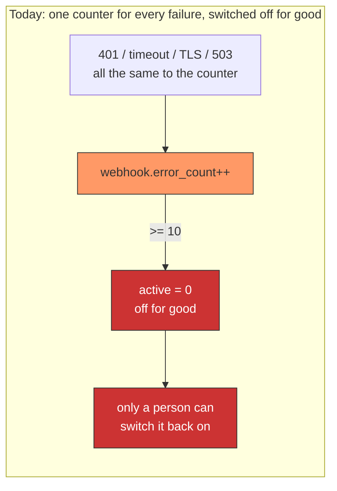
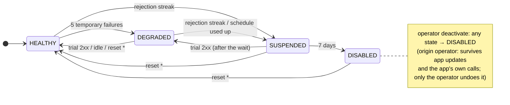
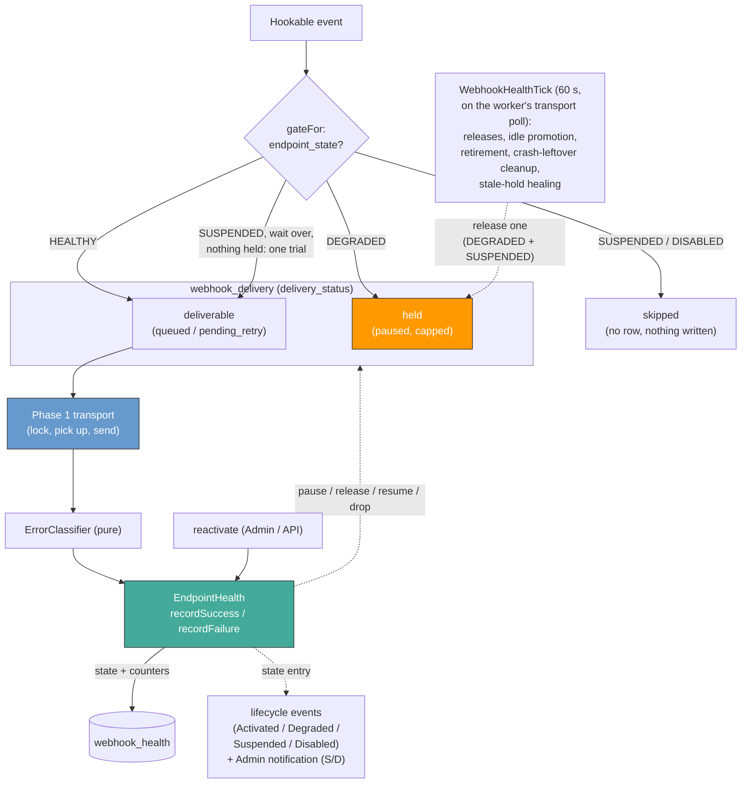
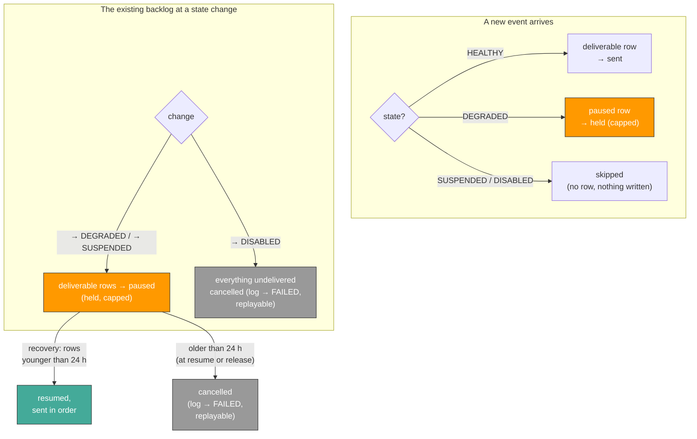
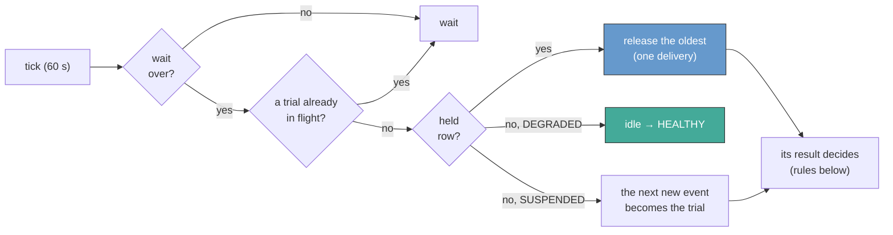
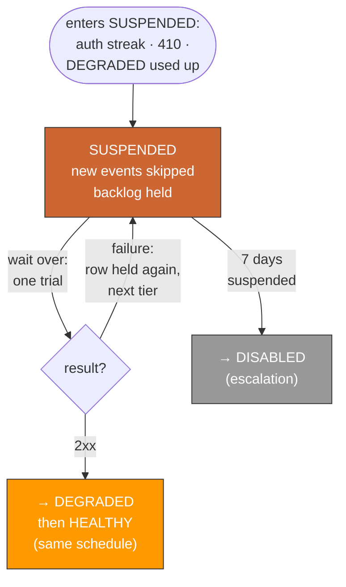

# Webhook endpoint health remodel

> Each webhook gets its own health state: HEALTHY, DEGRADED, SUSPENDED or DISABLED.
> A failing endpoint is paused, tested again on a growing schedule, and recovers by itself on a real success; a suspension always ends in a decision.
> It replaces the `error_count` that switches a webhook off for good, behind the `WEBHOOKS_REWORK` flag.
> Health decides *whether* a delivery may go out; it never changes *how* it is sent.

Tracking: [shopware/shopware#16565](https://github.com/shopware/shopware/issues/16565) (follow-up to [#16560](https://github.com/shopware/shopware/issues/16560)).
Foundation: [`adr/2026-04-14-webhook-outbox-transport.md`](2026-04-14-webhook-outbox-transport.md).

## Context

Phase 1 of the webhook rework writes each business event to an *outbox* first: a row in `webhook_event_log` plus a row in `webhook_delivery`.
A worker then picks the row up and sends it to the app.
Synchronous delivery uses the same rows.
The *transport* is the Phase 1 code that picks these rows up and sends them.
Its *lease* is a per-app lock: one worker at a time delivers an app's events, first attempts in the order they were written, while retries may arrive later.
Phase 3, the next step of the rework, has its own ADR.
Phase 1 replaced how deliveries are sent, but failures are still handled by the old stopgap on top of it:

1. Every failed delivery makes `RetryWebhookMessageFailedSubscriber` increment `webhook.error_count`.
2. At `error_count >= 10` the webhook is set to `active = 0` and stays off until someone switches it back on.

One counter cannot tell a `503` (server briefly down) from a `401` (credentials rejected), so the only outcome it can reach is switching the webhook off for good:

| Problem | Impact |
|:---|:---|
| **No error kinds.** One counter for every failure. | A `401` and a `503` escalate at the same rate. |
| **No automatic recovery.** `active = 0` is an off switch. | A 10-minute outage still needs a person to switch the webhook back on, often hours later. |

The parties are the **operator** (the merchant running the shop), the **app vendor** (who owns the endpoint) and **Shopware** (which sends the deliveries).

Running example: an app's endpoint starts answering `503` at 12:00 and stays broken until 22:15.

## Decision

Every webhook gets its own **health state**, behind the existing `WEBHOOKS_REWORK` flag.
With the flag off, the shop does exactly what trunk does: the health services are registered either way, but every entry point returns on the flag before its first query.

| State | New events | Delivery | Way out |
|:---|:---|:---|:---|
| **HEALTHY** | written as deliverable rows | yes | none needed |
| **DEGRADED** | written as held (`paused`) rows | paused; one trial at a time after each wait | trial `2xx`, or idle promotion (nothing held, nothing in flight) → HEALTHY |
| **SUSPENDED** | **skipped: no row, nothing written** | no; rows queued before the suspension stay held, and too-old ones are cancelled when they would go out again | after each wait one delivery is tried: the oldest held one, else the next new event; each `2xx` climbs one state. App install/update → HEALTHY. 7 days → DISABLED |
| **DISABLED** | no | no; everything undelivered is cancelled | disabled by escalation: app install/update or a manual switch-on. Disabled by the operator: **only the operator** undoes it |

| Diagram label | Meaning |
|:---|:---|
| 5 temporary failures | `degraded_threshold`; counts only from HEALTHY |
| rejection streak | 3 `401`/`403` in a row with no `2xx` in between; `410` trips at once; `404` counts as temporary |
| reset \* | a clean slate from an app install/update (DISABLED: only when disabled by escalation), the app's reactivate API (refused when the operator disabled it), or a manual switch-on |
| 7 days | `suspended_since + max_suspended_days`; survives a re-suspension, pauses while the app is deactivated |

The rules:

1. **Every result gets a kind.**
   A pure function sorts each result into temporary, rejection or this-message-only ([Error classification](#error-classification)).
   Suspension needs 3 rejections in a row, so a single stray `401`/`403` from a firewall or CDN challenge can't trip it.
2. **One recovery schedule for DEGRADED and SUSPENDED.**
   After each wait, exactly one delivery goes out as a trial.
   Each `2xx` climbs exactly **one state** toward HEALTHY.
   An app install or update also resets health to a clean slate.
3. **Queued work is held, not dropped.**
   Rows queued when a webhook trips are held.
   When they would go out again, rows older than 24 hours are cancelled and stay replayable instead of arriving stale.
   Only DISABLED cancels everything held.
4. **State changes are pushed.**
   Every state entry emits a business event; SUSPENDED and DISABLED also write an Admin notification.
5. **The operator's off switch wins.**
   `disabled_origin` records who disabled the webhook: `operator`, or `escalation` when Shopware did it automatically.
   Automation never undoes an operator's decision; only the operator's `PATCH active = true` does.
6. **Suspension has an end.**
   SUSPENDED becomes DISABLED after a configurable number of days, 7 by default.

Health is per webhook: an app with five subscriptions has five separate health states, and a `401` on `/customers` does not pause `/orders`.
One timing caveat: until `PartitionAwareHookable` (Phase 3), all webhooks of one app share one lease.
A failing webhook can therefore *delay* its siblings, but never degrade or disable them.
Blame is per webhook; delivery speed is shared per app.

### Building blocks

1. **`EndpointHealth`** owns the `webhook_health` table and every state change.
2. **`ErrorClassifier`** is a pure function from HTTP status to a kind: same input, same answer, no database, no clock.
   Status `0` means no response arrived.
   Everything stateful stays in the service.
3. **The gate.**
   For each new event, `WebhookManager` asks `gateFor`: deliver, hold or skip.
   The transport writes exactly that answer: a deliverable row (HEALTHY), a `paused` row (DEGRADED), or nothing at all (SUSPENDED, DISABLED).
   Nothing later decides again.
   The answer can be a moment out of date if the state changes at the same instant, and both cases heal: a deliverable row on a webhook that just suspended goes out once and its result counts like any other, and a `paused` row on a webhook that just recovered is resumed by the health tick within a minute.
4. **The `paused` delivery status** is the held state.
   Workers never pick it up, so health controls delivery only by pausing and releasing rows.
   The Phase 1 code that picks up, locks and sends rows does not change.
5. **The `WEBHOOKS_REWORK` flag** is the Phase 1 flag; off keeps the old failure handling.
   It switches behaviour and I/O, not service registration: the health service, tick, subscribers and events are always registered, and each entry point returns on the flag before doing any work.
   The entry points are `WebhookTransport::get()`, the delivery service's result handling, the app-lifecycle and active-flag subscribers, and the health routes.
   The notification subscriber reacts only to lifecycle events, which only those entry points emit.

Health and the transport meet only at `delivery_status`.
Health writes pause, release, resume and drop; the transport sends deliverable rows.
Neither reads the other's columns.

### New events and the queued backlog

The gate decides only *new* events.
When a webhook changes state it usually still has queued rows the workers haven't sent; left deliverable, they would keep hitting an endpoint that was just judged bad.

- **DEGRADED holds.**
  Deliverable rows flip to `paused` in one bulk write (a *flip*) and resume on recovery.
- **SUSPENDED holds too, with an age limit.**
  Held rows wait for recovery or DISABLED, but nothing older than **24 hours** (fixed, counted from the row's creation) is ever sent again.
  The check runs wherever held rows would go out again, for a bulk resume and a single release alike; too-old rows are cancelled there, and the replay surface is how to get them back.
- **Cancelling removes only the delivery.**
  The `webhook_event_log` row stays: FAILED, `failure_reason = endpoint_suspended`, payload kept, replayable.
  A wrong suspension costs time, never queued work younger than a day.
- **Every return to HEALTHY resumes the held rows** (age limit applied), whether through the schedule, a manual switch-on, the API or an app reset.
  No held row outlives recovery.
- **New events during SUSPENDED are skipped: no row, nothing written.**
  DEGRADED keeps new work and SUSPENDED drops it.
  That difference *is* what separates the two states, and skipping costs no I/O.
  Apps can bound the skipped window with `suspended_since` on `GET /state`.
- **Order is never broken, but a gap can exist.**
  Held rows resume ahead of newer traffic, oldest first by row id.
  After recovery the receiver sees the events from before the suspension, then a gap (the skipped window), then live traffic.
  Skipped events used no sequence numbers, so the gap shows only on `/state`; the Admin notification marks the trip and the recovery.
- **The transport doesn't change.**
  `paused` just isn't picked up; held rows come back only through a single release or a bulk resume, one transaction per flip.
  The transport stores what the gate decided; there is no second decision.
- **Two timing races heal by themselves.**
  A row written deliverable on a webhook that just suspended goes out once, and its result counts like any other.
  A row written `paused` on a webhook that just recovered is resumed by the health tick within a minute.

A delivery already in flight (`running`) when the state changes:

| Situation | What happens |
|:---|:---|
| A worker is mid-delivery during a state change | The HTTP call finishes and its result is recorded like any other, or ignored if its row is already gone. |
| A crash leftover is re-queued on a webhook that is now SUSPENDED | It must not just go out. Crash recovery cancels it before a worker can pick it up, and the health tick cancels any extra deliverable row; only the one row released on purpose may be in flight. |
| The webhook becomes DISABLED | Everything undelivered (queued, held, in flight) is cancelled; an operator's off switch also stops a backlog that could still be delivered. A worker that finishes late writes into a deleted row and changes nothing. |

**What a flip costs, and why it is bounded.**
A flip is one bulk write that locks the rows until it commits, and every other query on those rows waits meanwhile, so the lock time stalls the webhook pipeline directly.
It writes *two* tables, because `delivery_status` exists on both `webhook_delivery` and the wide `webhook_event_log` (`fetchDue` reads `el.delivery_status`).
`webhook_event_log` also stores request and response payloads (about 3 KB per row), so once it no longer fits in MySQL's buffer pool (the memory that keeps recently used pages) its write dominates.
Measured for a pause flip on MySQL 8.4 with a 128 MB buffer pool:

| Rows touched | Lock time (delivery + event log) |
|---:|---:|
| 1 k | ~55 ms |
| 10 k | ~370 ms |
| 100 k | ~8.7 s |
| 1 M | ~184 s |

Cancelling the held rows (`DELETE` from `webhook_delivery`, `webhook_event_log` → FAILED, the same operation the DISABLED escalation runs) has the same shape and size.
The large counts need two faults at once: dead workers build a big backlog, *then* the state changes.
So 100 k and above describe a shop whose workers are down, not a running shop.
The bound is also designed, not lucky: **`max_paused_backlog`** (default `10_000`, about 0.4 s per flip) ships **in the same release** as part of Phase 3 and caps every held set, both the DEGRADED hold and the SUSPENDED hold.
The full cap contract is under [Must ship together](#must-ship-together).

### Error classification

Failures come in three kinds.
**Temporary**: probably passes, worth retrying.
**Rejection**: the endpoint itself refuses us, and retrying won't change the answer.
**This message only**: the message is the problem, and the endpoint's health must not suffer for it.

`ErrorClassifier::classify(int $status)` returns one value, with no other input and no state; status `0` stands for a transport failure without a response.
The classifier only says *what kind* of failure it was.
*When* to retry is decided separately in `WebhookDeliveryService`: it computes `next_retry_at` from the `RetryDelayCalculator` schedule (`[5 s, 30 s, 5 m, 30 m, 4 h]`, at most 4 h) and applies a `429`'s `Retry-After` where the failure is handled.

| Response | Delivery | Health |
|:---|:---|:---|
| `2xx` | success | reset both failure counters, clear the wait; DEGRADED → HEALTHY |
| `404`, `408`, `5xx`, network, DNS, timeout, TLS handshake | retry with backoff, between 5 s and 4 h | `consecutive_transient_failures++`; reaching the threshold → DEGRADED (from HEALTHY only) |
| `429` (rate limited) | retry after `Retry-After`, between 1 s and 4 h | `consecutive_transient_failures++`; counts toward the DEGRADED threshold (from HEALTHY only) |
| `400`, every other unlisted `4xx` | fail at once | **no health change**: the message is the problem, not the endpoint |
| `3xx` (a redirect we don't follow) | fail at once | `consecutive_transient_failures++`. A lasting redirect is endpoint setup, not message content, so it escalates through DEGRADED instead of failing silently forever. |
| `401`, `403` (credentials rejected) | fail at once | `consecutive_non_transient_failures++`; a streak of `non_transient_threshold` (default 3) → SUSPENDED. Counted once per delivery, reset by any `2xx`; temporary failures neither add to it nor reset it. |
| `410` (gone for good) | fail at once | → SUSPENDED at once: `Gone` is the endpoint saying it was retired |

"From HEALTHY only" means the temporary-failure threshold trips only HEALTHY → DEGRADED.
Once a webhook is DEGRADED or SUSPENDED, temporary failures feed the [recovery schedule](#recovery-one-schedule-for-degraded-and-suspended) instead.

Why the lines are drawn here:

- **`400` and unlisted `4xx` never touch health.**
  One malformed event must not block thousands of good ones.
  The default branch has no health effect, so no status class goes unhandled.
- **One `401`/`403` is a blip, not a verdict.**
  Firewalls, CDN challenges and OAuth gateways send stray auth errors in front of healthy endpoints, so suspension needs a streak (`non_transient_threshold`, default 3, no `2xx` in between).
  Waiting costs a couple of failed deliveries; not waiting halted delivery on one stray response.
  No mainstream platform trips on a single response.
- **`404` is temporary.**
  It is usually a deploy or setup change in progress, and a *lasting* `404` still escalates through DEGRADED.
  `410 Gone` is the explicit retirement signal and suspends at once.
- **TLS handshake errors are temporary.**
  Certificate renewals, CDN restarts and DNS hiccups cause single TLS errors, and a lasting misconfiguration still escalates through the threshold.
  Some reachability checks treat DNS and TLS as fatal; this design deliberately doesn't ([Alternatives](#tls-failures)).
- **`Retry-After` is kept between 1 s and 4 h**; a value outside that falls back to the schedule.

### Recovery: one schedule for DEGRADED and SUSPENDED

Recovery works like a circuit breaker: stop sending to a failing endpoint, wait, then let exactly one *trial* delivery through and judge its result.
Both DEGRADED and SUSPENDED use the same mechanism:

- **One schedule.**
  `cooldown_schedule_seconds` (5 m → 4 h), per webhook.
  Each step on it is a *tier*; the current tier's length is the *wait*.
  Tier 0 must be longer than the 20-second delivery timeout so that deliveries already in flight when the webhook tripped finish before the first trial; the configuration requires at least 21 seconds.
- **One delivery at a time.**
  When the wait is over, one row is released as the trial.
- **One success rule.**
  A `2xx` climbs exactly one state toward HEALTHY.
- **One clock.**
  `WebhookHealthTick` runs every 60 s and handles every time-based job as a cheap indexed check per webhook: releases, idle promotion (below), the 7-day retirement (skipping deactivated apps), cleanup of crash leftovers (cancel re-queued rows on SUSPENDED webhooks), and healing of stale holds (resume rows left `paused` by a race).
  It uses short transactions, makes no HTTP calls and holds no locks; released rows go out through the normal worker path.

**What drives the clock.**
The delivery worker's transport poll triggers the tick, not a scheduled task: a scheduled task's cadence belongs to the host (cron or the admin worker, commonly around 10 minutes) and cannot keep 60 s.
Each worker poll passes an in-memory check that allows one tick per interval per worker.
There is deliberately no choosing of one worker across the fleet: every job is a single guarded statement or a per-webhook `FOR UPDATE` transaction, so overlapping workers only cost a few repeated indexed scans, never a wrong state change.
After a completed tick the worker writes a heartbeat (an `app_config` key) that the health-status endpoint reports.
A worker that delivers is, by definition, alive exactly when health has decisions to make; if no worker polls the webhook transport, nothing is delivered either, so there is nothing for the clock to judge.

On HEALTHY → DEGRADED the deliverable backlog flips to `paused` in bulk, and new events while DEGRADED are written `paused` directly.
On each tick, for every DEGRADED or SUSPENDED webhook whose `cooldown_until` has passed:

- **The previous trial is still in flight** (a deliverable or `running` row exists): nothing happens this tick.
- **A `paused` row exists and nothing is in flight**: release the oldest (→ `pending_retry`, due now).
  A release on its own never counts as a step on the schedule.
- **Nothing held, nothing in flight**: DEGRADED is promoted as idle (below).
  SUSPENDED lets the **gate** admit the next real event as the trial.
  A guarded `UPDATE` re-arms the lease first and succeeds for only one caller, so a burst of events can't create several trials.
  SUSPENDED is never promoted as idle.

The released row's result decides, one state per `2xx`:

1. **`2xx`**: SUSPENDED → DEGRADED with the schedule back at tier 0, because one success after a deep failure isn't proof of health; HEALTHY is earned through the same schedule.
   DEGRADED → HEALTHY: all `paused` rows resume, age limit applied, sent in the app's delivery order.
2. **Temporary failure**: the row is held again and the schedule climbs one tier (up to 4 h).
   This also applies to a trial taken from real traffic: its row joins the held set, which therefore grows by at most this one row while SUSPENDED.
   While DEGRADED, the same tier number counts the cycles: reaching the end of the schedule → SUSPENDED.
3. **Rejection**: the row fails, the auth streak grows (→ SUSPENDED at the threshold), and it counts as a failed trial.
4. **This message only (`400` family)**: fails *that row only* and does **not** use up the trial; the next-oldest held row is released at once.
   Only endpoint-level results decide recovery, so one malformed payload at the front of the held set can't block it.

One rule per released row, however it was released.

**Only trials move the schedule:**

| Row | Moves the schedule when it fails? | Counted when |
|:---|:---|:---|
| Trial released by the tick (the oldest held row) | yes, exactly once | when its result arrives, and only if the wait was already over at that moment |
| Trial admitted by the gate (real traffic while SUSPENDED) | yes, exactly once | when it is admitted; its result doesn't count again |
| A delivery already in flight when the webhook tripped | no | never; the row is just held again |
| A row brought back by crash recovery | no | never; the row is just held again |

Only one trial can be out at a time: the tick checks for in-flight rows before releasing, and the gate claims its admission through the lease.

**One position on the schedule.**
The position is a single field, `degraded_cycle_count`, in both states.
It resets to 0 when a `2xx` moves the webhook into DEGRADED, and on every direct trip by a rejection.
In DEGRADED the same number counts the cycles, so there is deliberately no `max_degraded_cycles` setting: the budget *is* the schedule's length, and changing the schedule changes it.

**Running example.**
The endpoint answers `503` from 12:00, and every trial fails with a temporary error until 22:15.
Times are idealized; the 60 s tick can add up to a minute per step.

| Time | What happens |
|:---|:---|
| 12:00 | 5th temporary failure → **DEGRADED** (tier 0); the backlog flips to `paused` |
| 12:05 – 14:15 | trials after 5 m, 10 m, 20 m, 40 m and 1 h all fail; the tier climbs 1 → 5 |
| 18:15 | the trial after 4 h fails; the schedule is used up → **SUSPENDED**, staying at the top tier |
| 22:15 | the trial after 4 h returns `2xx` → **DEGRADED**, tier 0 |
| 22:20 | the trial after 5 m returns `2xx` → **HEALTHY**; held rows younger than 24 h resume |

**Idle promotion** (DEGRADED only: nothing held, nothing in flight → HEALTHY) resets the tier and the wait but **keeps the temporary-failure streak**.
Nothing was delivered, so nothing proved health: the first temporary failure after traffic returns degrades the webhook again at once, and a real `2xx` clears the streak.
HEALTHY is the right resting state, because a "stay DEGRADED" rule would stick a webhook without traffic there forever.
Idle promotion never fires while a trial is still pending.

### What SUSPENDED adds

SUSPENDED is not the end.
The backlog from before the suspension stays held (age limit applied at resume), new events are skipped, and recovery uses the shared schedule.
Three rules are specific to SUSPENDED:

- **Where it starts on the schedule.**
  A direct trip (auth streak or `410`) starts at tier 0, so the first trial comes after 5 m and a blip recovers in minutes.
  Arriving from a used-up DEGRADED schedule keeps the top tier: an endpoint that already spent about 6 hours on trials gets no fast retries.
  Each failed trial climbs one tier, up to 4 h.
- **Trials from real traffic.**
  With nothing held, the gate admits the next real delivery as the trial.
  It is treated like any released row: a temporary failure holds it, so the held set grows by at most this one row while SUSPENDED.
- **No idle promotion.**
  Without a `2xx`, SUSPENDED ends only through a reset (below) or the time limit.

The trial is a real delivery, so recovery works whatever caused the trip and can't recover by mistake.
Broken credentials keep returning `401` and never recover this way; they recover through the clean-slate reset below or manually.
A `404` or `410` recovers only if it really was a blip.

The only point where Shopware gives up is the **7-day limit**, counted in real time whether or not traffic flows:

- `suspended_since` is written when the webhook **first** enters SUSPENDED and is not overwritten until full recovery; writers set it only when it is empty.
  A SUSPENDED → DEGRADED → SUSPENDED loop does **not** restart the clock; the field is cleared only on reaching HEALTHY.
- After `max_suspended_days` (default **7**) the health tick retires the webhook to DISABLED with `disabled_origin = escalation`.
  This depends on time, not traffic, so a dead endpoint with no traffic still retires.
- **The clock pauses while the app is deactivated.**
  A deactivated app's events are filtered out before the gate, so its webhooks get no trials, and counting that time would be unfair.
  The retirement check therefore skips webhooks of deactivated apps, *and* reactivation moves `suspended_since` forward by exactly the deactivated time.
  Suspended 2 days, app deactivated 3, then reactivated: the clock reads 2 days, not 5.
  Only skipping the check would retire the webhook on the first tick after reactivation.
- There is no counter of suspension cycles: the wait is already driven by time, and a counter would only repeat the elapsed time.

### Clean-slate reset on app install or update

An app install or update (`AppInstalledEvent` / `AppUpdatedEvent`) is a deliberate operator action that replaces exactly what usually broke the endpoint, its configuration and credentials, so it counts as a clean slate:

- `reactivateForApp` resets every webhook of the app that isn't HEALTHY (DEGRADED, SUSPENDED or DISABLED) to HEALTHY, except one the operator disabled (`disabled_origin = operator`).
  The merchant's explicit off switch survives a routine app update; only the operator undoes it, with `PATCH active = true` in the Admin.
- For a webhook DISABLED by escalation, this is the **only** automatic way back.
- It resets the health state, not the gate: later events flow because the state allows it, and nothing skips the gate.
- Known gap: rotating the app secret through the bare CLI or API fires no install or update event.
  Such webhooks recover through a manual switch-on.

### Lifecycle events and notifications

Every state change is pushed as a business event; SUSPENDED and DISABLED also notify the operator.

| State entered | Business event | Admin notification |
|:---|:---|:---|
| HEALTHY (any path) | `WebhookActivatedEvent`, with the trigger: trial `2xx`, idle promotion, manual, app reset, or the app's reactivate API. It replaces the earlier `WebhookReactivatedEvent`. | a short recovery notice when a suspended webhook recovers |
| DEGRADED | `WebhookDegradedEvent` | none: it heals itself routinely, so events yes, alarm no |
| SUSPENDED | `WebhookSuspendedEvent` | yes, **one per suspension**, keyed on the unchanged `suspended_since`; a webhook that trips again before reaching HEALTHY doesn't notify again |
| DISABLED | `WebhookDisabledEvent` | yes, always |

- **Best effort.**
  Events are sent after the commit, and a failing listener never affects the state change.
  Events are advisory; the `webhook_health` row is the truth.
  Events plus structured logs are also the record of who did what; there is no separate audit table.
- **Payload contract.**
  Ids, names, coarse state and cause values, and timestamps; never the endpoint URL, headers, delivery payloads, exception messages or counts.
  Every event carries:
  - `webhookId`;
  - `webhookName`, the vendor's key into `GET /state` and `POST /reactivate`, which both work by name;
  - `eventName`, the subscription of the affected webhook, which makes an operator's Flow rule readable;
  - `fromState`;
  - `occurredAt`, the time of the state change itself.
    The envelope timestamp is per delivery *attempt*, so a held event delivered late would otherwise carry no time for the change.

  `WebhookSuspendedEvent` adds `suspendedSince` (the start of this suspension) and `cause` (`auth_streak` | `gone` | `schedule_exhausted`).
  The fix differs per cause (rotate credentials, fix a retired URL, wait for recovery), and a machine-readable value is part of the contract where fix *text* is not.
  The rule of no counts and no fix instructions still applies to the wording of the Admin notice.
- **Webhooks without an app see everything, on purpose.**
  A webhook without an owning app always passes the dispatch check, so an operator-created webhook subscribed to `webhook.health.*` receives every app's health events, names included.
  That channel has the same trust level as the Admin; webhooks owned by an app only ever see their own app's events.
- **One notification per suspension**, because repeated alarms from an endpoint that keeps flipping would teach operators to ignore the channel.
- **The recovery notice closes the loop**, deliberately without counts or fix instructions: the merchant and the app vendor are different parties, and acting on the gap is the vendor's job.
  The vendor's record is `GET /state` (`suspended_since` up to recovery bounds the window) plus the replayable FAILED rows.
  Replayed deliveries are ordinary subscribed events, so recovery never brings a new event type an app has to learn.

### Defaults

| Setting | Value | Why |
|:---|:---|:---|
| `degraded_threshold` | 5 temporary failures | One short outage produces 4 or 5 retries; the 5th flips to DEGRADED, so a single spike doesn't pause delivery. |
| `non_transient_threshold` | 3 in a row | Firewalls, CDN challenges and OAuth gateways send stray `401`/`403`s in front of healthy endpoints. Three failed *deliveries* with no `2xx` in between is endpoint-level evidence a blip can't fake. `410` skips the threshold; `404` is temporary. Reset by any `2xx`. |
| Backlog age limit | 24 h, **a fixed constant, not a setting** | Applied wherever held rows would go out again (resume and release): younger rows go out, older ones are cancelled (FAILED, replayable). How stale is too stale doesn't vary per shop; the replay surface is the configurable way out. Held sets are bounded by `max_paused_backlog`. |
| `cooldown_schedule_seconds` | `[300, 600, 1200, 2400, 3600, 14400]` | 5 m → 10 m → 20 m → 40 m → 1 h → 4 h: doubling for five tiers, and the last jump from 1 h to 4 h matches Phase 1's longest retry budget for one delivery. |
| DEGRADED budget | derived from the schedule: 5+10+20+40+60+240 min = 375 min ≈ 6 h 15 m | Not a setting; the schedule's length is the budget, so changing the schedule changes it. An endpoint that can't recover in six hours is broken, and SUSPENDED is the honest label. |
| Starting tier in SUSPENDED | tier 0 (5 m) on a direct trip; the top tier when coming from a used-up DEGRADED | The shared schedule, no new setting: an endpoint tripped by a blip recovers in minutes, and one that already spent about 6 h on trials keeps waiting 4 h. |
| `max_suspended_days` | 7 | A week before retiring to DISABLED: in line with common per-endpoint practice (a few days), and short enough that abandoned apps leave the delivery path. Configurable up to 14. Recovery (schedule, install/update, manual) stays available the whole time. |
| Health tick | 60 s, a constant on `WebhookHealthTick`, not in the health config | One clock for every time-based job, with cheap indexed checks. Triggered by the worker's transport poll, at most once per interval per worker, with overlapping workers absorbed by the job guards. The shortest wait is 300 s, so a due trial is never late by more than a fifth of its wait. |

The settings `degraded_threshold`, `non_transient_threshold`, `cooldown_schedule_seconds`, `max_suspended_days` and the co-shipped `max_paused_backlog` live under `shopware.webhook.health.*`.
Everything else above is a constant or derived.

### Storage and APIs

Health lives in an **internal `webhook_health` table**: plain SQL, not a DAL entity.
Shopware's Data Abstraction Layer (DAL) puts every column of an entity on the public CRUD API, so as DAL fields all eight operational columns would become part of the public `/api/webhook`, which can't change without a major release ([Alternatives](#where-health-lives)).
The table follows Phase 1's pattern of raw operational tables: one row per webhook, primary and foreign key with `ON DELETE CASCADE`, so deleting a webhook deletes its health row.
Its eight fields are the state; three counters (temporary streak, rejection streak, position on the schedule); the `cooldown_until`, `suspended_since` and `disabled_since` timestamps; and `disabled_origin` (`operator` | `escalation`).

- **Other additions:** the `paused` delivery status, `webhook_event_log.failure_reason`, and one `app_config` key, `webhook.health.tick.completed_at`, which is the tick heartbeat and is absent until the first completed tick.
  The clock needs no table, and there is no audit table: the lifecycle events and structured logs record who did what.
- **Old columns kept in sync:** `webhook.active` and `error_count` are still written, derived from health on every state change, so reads *and* filters on `/api/webhook` keep working.
- **Migration:** `INSERT … SELECT` from `webhook`; `active = 0` becomes DISABLED with `disabled_origin = escalation`.
  A known trade-off: an operator's disable from before the migration can't be told apart from an automatic one, so an app update can revive it.
  That isn't new: before the rework, every app update already switched manifest webhooks back on, and the same rescue path stays.

Three new app-system endpoints and one Admin endpoint:

| Endpoint | Auth | Purpose |
|:---|:---|:---|
| `GET /api/app-system/webhook/state` | app credentials | Health per webhook for the calling installation, including the current `url`, `suspended_since` / `disabled_since`, and `disabled_origin`. |
| `POST /api/app-system/webhook/reactivate` | app credentials | Switches one or more webhooks back on; 10 calls per minute per integration, at most 50 ids per call. **Refuses webhooks the operator disabled**: that recovery belongs to the operator. |
| `GET /api/_action/webhook/health-status` | Admin | The tick heartbeat (the `webhook.health.tick.completed_at` `app_config` key: the last completed tick, plus a `stale` flag), for self-hosted monitoring. |
| `POST /api/_action/webhook/{id}/deactivate` | Admin | The operator's off switch: → DISABLED with `disabled_origin = operator`, from **any** state. It exists because `PATCH active = false` can't express intent on a SUSPENDED or DISABLED webhook, whose synced value is already `false` (write rules below). |

The replay surface over FAILED `webhook_event_log` rows, covering the cancelled backlog and retries that ran out, ships in the same release and is specified in the Phase 3 ADR.
Skipped events have no rows by design; apps reconcile that window by time through the DAL API.

**Reads.**
`active` and `error_count` are derived from the new state (table below) and reported next to `endpoint_state` on the health API.
`/api/webhook` carries only the synced columns: the health fields are deliberately not on the DAL API, and live status lives on the health API.

The sync must never show an old client a broken webhook with `error_count = 0`, and an auth-suspended endpoint's temporary counter may never have moved.
So `error_count` takes the larger of the two failure streaks:

| `endpoint_state` | `active` | `error_count` | Admin label |
|:---:|:---:|:---:|:---|
| `healthy` | `true` | `0` | Active |
| `degraded` | `true` | larger failure streak: `GREATEST(transient, non-transient)` | Degraded, retrying |
| `suspended` | `false` | larger failure streak | Suspended, delivery paused |
| `disabled` | `false` | larger failure streak | Disabled, requires action |

**Writes.**
Without a guard, the Admin saving a suspended webhook back unchanged (a full-entity save that writes `active = false` again) would count as an operator's off switch.
So intent is read only from writes that actually *change* the value:

| Write | Changes the synced value? | Effect |
|:---|:---|:---|
| `PATCH active = true` | yes, it was `false` | switches the webhook on: the operator's gesture, whatever `disabled_origin` says |
| `PATCH active = false` | yes, it was `true` | operator's off switch → DISABLED, `disabled_origin = operator`; the change carries the intent |
| `PATCH active` with the value it already has | no, it only echoes (for example a full-entity save while suspended) | **nothing happens**: an echo carries no intent; the clear gesture is the dedicated action below |
| `POST /api/_action/webhook/{id}/deactivate` | not a value write | operator's off switch → DISABLED, `disabled_origin = operator`, in any state |

Value changes and the dedicated action are the only signals of intent, so the synced columns can never feed back into the state machine.
Automation that uses the old off/on toggle gets the off-switch behaviour; the v6.8.0 release notes say so.

**Meaning shift:** from v6.8.0, `active = true` means the webhook *may* receive deliveries.
A DEGRADED webhook reports `active = true` while delivery is briefly paused.
The v6.8.0 release notes document it.

## Alternatives

Only the contested decisions are listed.

### Where health lives

| Option | Why not |
|:---|:---|
| Columns on the `webhook` DAL entity | The DAL requires every column to be a declared public field, so the eight operational columns would become part of the public `/api/webhook`, which can't change without a major release. Raw guarded writes to a DAL entity also skip its event and write-protection pipeline. Fast-changing operational state doesn't belong on a public configuration entity. |
| A cache (Redis or in-memory) as the source of truth | The textbook store for a circuit breaker, but a cache flush would lose the suspension clock, the Admin UI data and `GET /state`, and health must survive restarts. Only the cache as the *source of truth* is ruled out: a cache in front of the table is a fine later optimization for the frequent `gateFor` read. Writes still land in `webhook_health`, and a stale read errs toward delivering rather than blocking and corrects itself. |
| **Internal `webhook_health` table (chosen)** | Matches Phase 1's raw operational tables (`webhook_delivery`, `webhook_stream`) and keeps health internal and off the public entity; a raw guarded `UPDATE` is its only writer. Syncing `active` and `error_count` covers the old API until v6.8.0. |

### How DEGRADED holds deliveries

| Option | Why not |
|:---|:---|
| `JOIN webhook` in the transport's fetch, plus a column pinning the current trial delivery (`active_probe_delivery_id`) | Ties health into the transport's locking and fetching, adds join and lock cost to the busiest query, and brought a cluster of concurrency edge cases: rows a transaction couldn't see yet, a pin cleared after it was already reused, and a lease spinning on nothing. |
| Reuse only `next_retry_at` (no new status; hold rows with a far-future time) | Gives `pending_retry` a second meaning, "held by health". Held rows then look like real retries, the skip and backlog gauges can't count them, and the retry scheduler writes the same field. Making that safe means teaching the transport's crash recovery about health, tying together exactly what this design keeps apart. More code than a new status, and worse separation. |
| **A `paused` delivery status the transport ignores (chosen)** | The transport already ignores statuses it can't pick up. Health owns the flip between `paused` and deliverable in its own states, with no field shared with the retry scheduler. One deliverable row among paused ones is exactly one trial. The transport doesn't change, and the held state can be queried directly. |

### The clock for time-based jobs

| Option | Why not |
|:---|:---|
| A scheduled task with a 60 s interval | The task *declares* 60 s, but the host decides the cadence: cron setups commonly run `scheduled-task:run` every few minutes up to tens of minutes, and the admin worker runs only while an Admin session is open. A due trial could wait most of its wait again just for the clock, and the schedule's timings stop being true. |
| Choosing one worker across the fleet, with a one-row compare-and-swap table or a distributed lock | Choosing one runner only removes repeated work that is already safe and cheap to repeat: every job is a guarded single statement or a per-webhook `FOR UPDATE` transaction, and the checks on an idle system are a handful of indexed queries on near-empty results. A dedicated table (or an `app_config` slot) for that is state nobody needs. A `LockFactory` lock can't even promise it: its default store is a file lock, per server, not shared across servers. |
| **The delivery worker's transport poll, at most once per interval per worker, no single runner (chosen)** | Messenger calls `get()` about once a second whether or not traffic flows: a free, always-present pulse on exactly the process that must be alive for health to matter. The per-worker in-memory check limits the cost to one tick per interval per worker, and the job guards absorb overlapping workers. After a completed tick the worker writes the heartbeat `app_config` key. The transport wrapper only carries the time pulse: picking up, locking and fetching stay unaware of health, and a failing tick is caught and logged, never thrown into the worker loop. |

### How SUSPENDED recovers

| Option | Why not |
|:---|:---|
| The opt-in `app.system_heartbeat` ping | Apps that don't subscribe never recover by themselves; the heartbeat is weekly and opt-in; and a `2xx` on it can come from a *different* endpoint than the broken one. |
| Actively checking reachability (a scheduled `HEAD` request to the webhook URL or a `baseAppUrl` health URL) | Rare in the industry. A `HEAD` proves the server answers, not that the real authenticated `POST` succeeds. It adds new scheduled outbound requests that can be pointed at internal addresses (server-side request forgery), and not every webhook has a `baseAppUrl`. |
| Reopening without a check: back to HEALTHY whenever the wait is over | Brings back an endpoint that is still broken with no evidence it was fixed; an endpoint with broken credentials would fail on the next event and flip back and forth. |
| **The shared recovery schedule: oldest held row, else real traffic (chosen)** | When the wait is over (5 m on a direct trip), exactly one delivery goes out: the oldest held row, released by the health tick so order is kept, else the next real delivery, admitted by the gate. A `2xx` steps down one state (SUSPENDED → DEGRADED), and HEALTHY is then earned on the same schedule. This is the standard circuit-breaker trial, and one mechanism instead of two. It can't recover by mistake: an endpoint with broken credentials never returns `2xx` and recovers through the clean-slate reset. Releasing held work first means recovery never spends a *new* business event while accepted work waits. |

### TLS failures

| Option | Why not |
|:---|:---|
| Treat DNS and TLS failures as rejections at once | Right where blocking too much is cheap, such as gating a sign-up form; wrong for webhook delivery, where a false suspension on a certificate-renewal blip drops business events. |
| **Classify TLS failures as `TransientNetwork`, a temporary network error (chosen)** | A lasting TLS misconfiguration still escalates through the normal DEGRADED threshold. |

### Events during SUSPENDED

| Option | Why not |
|:---|:---|
| Queue new events and deliver them on recovery | Rows pile up for the whole suspension, the busy queue grows, and on recovery everything arrives at once. |
| Hold the backlog indefinitely and send all of it on recovery | After a suspension of several days this sends events days old mixed with fresh ones, a large jump in time for the receiver. The *bounded* age limit keeps the hold without the staleness. |
| Cancel the backlog at the moment of suspension | A single stray rejection (a firewall rule, a CDN challenge, a `404` during a deploy) would cancel every queued delivery the moment it tripped the webhook. No mainstream delivery platform throws away accepted work on a single response. The streak rule makes the trip harder; the age limit removes the haste. |
| **Hold; apply the age limit wherever rows go out again; skip new events (chosen)** | On suspension the backlog is paused (the same flip as DEGRADED, capped by `max_paused_backlog`) and stays held until recovery or DISABLED, with no background sweep. Wherever held rows would go out again (resume and release), rows older than 24 h are cancelled, **the delivery only**: the `webhook_delivery` row is deleted, and the `webhook_event_log` row becomes FAILED with its payload kept, which is what the replay surface works from. Younger rows go out. New events are skipped outright, **no row, nothing written**, so the log grows only while a webhook can be delivered to (the deliberate contrast with DEGRADED's hold), and skipping costs no I/O. Receivers reconcile the skipped window by time (`suspended_since` on `GET /state`); nothing older than the age limit is ever sent again. |

### Rejected simplifications

A dedicated simplification pass proposed six cuts.
Two shipped: the shared recovery schedule, and the age check at resume that replaced a separate sweep.
Four were rejected, each because of a concrete failure:

| Proposed cut | Why it stays |
|:---|:---|
| Replace `degraded_cycle_count` with a wall clock plus "at least one trial result seen" | The failure: a trial is released at +5 m, and its result arrives 6 h later because the workers lagged. Time elapsed? Yes. One result seen? Yes. The webhook would suspend on a single result. The counter reads 1 of 6 and protects against exactly this: it moves on evidence. |
| Restart `suspended_since` on app reactivation instead of moving it forward | `suspended_since` is what apps use to bound the skipped window on `GET /state`, and the key that sends one notification per suspension. Restarting it makes apps underestimate the window they missed. |
| Remove idle promotion | The first event after a quiet period would wait out the *rest* of the current wait (up to 4 h), and a webhook without traffic would show DEGRADED forever, exactly the trap idle promotion prevents. A real cost for shops with little traffic. |
| Count `410` in the rejection streak | A retired endpoint with little traffic would stay "healthy" until three real business events failed against it. `Gone` is the endpoint's own retirement signal, and handling it at once is one line. |

## Before / After

| Concern | Before | After |
|:---|:---|:---|
| **What switches a webhook off** | 10 errors of any kind → off for good | `degraded_threshold` temporary failures (default 5) → DEGRADED; 3 rejections in a row (`410` at once) → SUSPENDED |
| **Recovery** | Only manually | One recovery schedule where each `2xx` climbs one state (SUSPENDED → DEGRADED → HEALTHY); clean slate on app install/update; 7-day limit → DISABLED; manual or API reactivation |
| **Error kinds** | All errors equal | 7 outcomes ([Error classification](#error-classification)): temporary, rejection, or this message only |
| **Coupling to the transport** | n/a | Health controls delivery through the `paused` status; the Phase 1 pick-up, lock and send code is untouched |
| **Events while suspended** | n/a | Backlog held, too-old rows cancelled when they would go out again (FAILED, replayable); new events skipped (no row; window reconciled through `/state`); a notification on the trip |

## Consequences

### Positive

- Automatic recovery at every state short of DISABLED, through one recovery schedule with one state per `2xx`.
  Recovery needs a real success, so a still-broken endpoint never recovers by mistake.
- Each failure kind gets its own handling.
  Auth and `Gone` errors retire fast, but never on a single stray response; temporary errors retry slowly; message errors never touch endpoint health.
  That means fewer false switch-offs and faster removal of dead endpoints.
- State changes are visible.
  Every state entry emits a best-effort event, and SUSPENDED and DISABLED add an Admin notification, one per suspension.
  The operator is told about a failure instead of finding it by checking.
- The operator's decision lasts.
  `disabled_origin` stops an app update, an app's own API call or an echoed value from undoing an operator's off switch.
- The API stays compatible.
  `active` and `error_count` keep working until they are removed in v6.8.0; the deprecation layer and the removal runbook ship with this stack.

### Negative

- Deliveries can still be lost during SUSPENDED and DISABLED:
  - Held rows past the age limit: the delivery is cancelled, and its `webhook_event_log` row stays FAILED and replayable.
  - New events are skipped with **no row at all**.
    This is deliberate: the log must not grow while a webhook can't be delivered to, or SUSPENDED would just be DEGRADED with worse rules.
    Skipped events can never be listed one by one; the loss is bounded by the window (`suspended_since` to recovery, both exposed) and reconciled by time through the DAL API.
  - Recovery adds no new outbound requests: the trial is a normal delivery.
- `active` changes meaning: a DEGRADED webhook reports `active = true` while delivery is briefly paused.
  Read `endpoint_state` for live status (v6.8.0 release notes).

### Must ship together

These ship in the same release as part of Phase 3.
They aren't optional: the lock-time numbers are only safe because the cap exists, and the replay API is how everything this design cancels gets recovered.

- **Cap on held rows** (`max_paused_backlog`, default `10_000`, configurable).
  The `paused` set works like a fixed-size queue: when a held set is full, each new row pushes out the oldest, whose delivery is cancelled and whose log row becomes FAILED, the same contract as any other cancel.
  It covers both holds, DEGRADED and SUSPENDED.
  It never touches the `queued` or `pending_retry` backlog of a HEALTHY webhook: a backlog there means *Shopware's own workers* are behind or down, not that the endpoint is bad, and those events must all go out once the workers are back.
  The cap bounds every pause, resume and drop flip (about 0.4 s at 10 k; see [what a flip costs](#new-events-and-the-queued-backlog)).
  Raising it trades a longer lock for more held history, the documented risk of a high cap.
- **Replay API** over FAILED `webhook_event_log` rows, covering the cancelled backlog and retries that ran out: the answer to "send again what was cancelled".

### Later

- Resetting `consecutive_transient_failures` after a quiet window, so an old failure count fades.
- Custom partition keys through `PartitionAwareHookable`: isolation at the level of the worker lease, which removes the shared per-app delay named under [Decision](#decision).
- A JSON payload format, batching deliveries to the same destination, and adapters for external ordered message brokers.

## For app developers

While an endpoint fails, Shopware holds accepted events, skips new events during SUSPENDED, and keeps cancelled held payloads replayable.

- **The receiving contract doesn't change.**
  The same headers and the same rule as Phase 1: receiving the same event twice must be safe, so deduplicate by `X-Shopware-Event-Id`.
- **Recovering from SUSPENDED needs one `2xx`.**
  After a wait, one trial goes out: your oldest held event, else the next event the shop triggers.
  A `2xx` steps the endpoint down to DEGRADED with no registration needed, and recovery sends the held events younger than a day.
  An endpoint suspended for **auth** won't recover this way: fix the credentials, then **install or update** the app (a clean slate) or call the reactivate API.
  Otherwise DISABLED follows after the limit (7 days by default).
- **Subscribe instead of polling for outages.**
  Every state entry fires a lifecycle event (`WebhookActivatedEvent`, `WebhookDegradedEvent`, `WebhookSuspendedEvent`, `WebhookDisabledEvent`, usable in Flow Builder), and SUSPENDED and DISABLED also write an Admin notification, one per suspension.
  The events go out like any other app event, so if your only endpoint is the broken one, polling `GET /state` is the backup; it exposes `suspended_since`, so the missed window can be computed exactly.
- **Getting missed events back:**

  | What was missed | How to get it back |
  |:---|:---|
  | Cancelled deliveries (the dropped backlog, retries that ran out) | Their `webhook_event_log` rows remain as FAILED, so they can be listed and replayed through the replay surface shipping in the same release, `*.deleted` events included (the payload was kept). |
  | Events skipped during a suspension | No rows exist. Reconcile the window by time, from `suspended_since` to recovery, through the DAL API. |
  | A `*.deleted` event (for example `product.deleted`) skipped during a suspension | The one case that can't be recovered: the entity is gone and nothing was recorded. Polling `GET /state` keeps this window short. |

- **Read `endpoint_state`, not `active`**, for live delivery status (the meaning shift is in the v6.8.0 release notes).
- **`GET /api/app-system/webhook/state`** returns health per webhook, and **`POST /api/app-system/webhook/reactivate`** (10 calls per minute per integration, at most 50 ids) is the way to recover by API.
  It can't switch on a webhook the operator disabled; that recovery belongs to the merchant.

## Rollout

Behind `WEBHOOKS_REWORK`, off by default.

## References

- [Webhook outbox transport](2026-04-14-webhook-outbox-transport.md): Phase 1, the delivery rows, lease and retry schedule this design builds on.
- [#19145](https://github.com/shopware/shopware/pull/19145): removed the copying of failure counts between webhooks with the same event and URL.

> A SUSPENDED or DISABLED webhook never recovers without a real `2xx` or a deliberate reset, every cancelled delivery stays replayable, and automation never undoes an operator's off switch.
