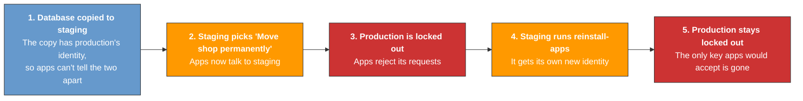
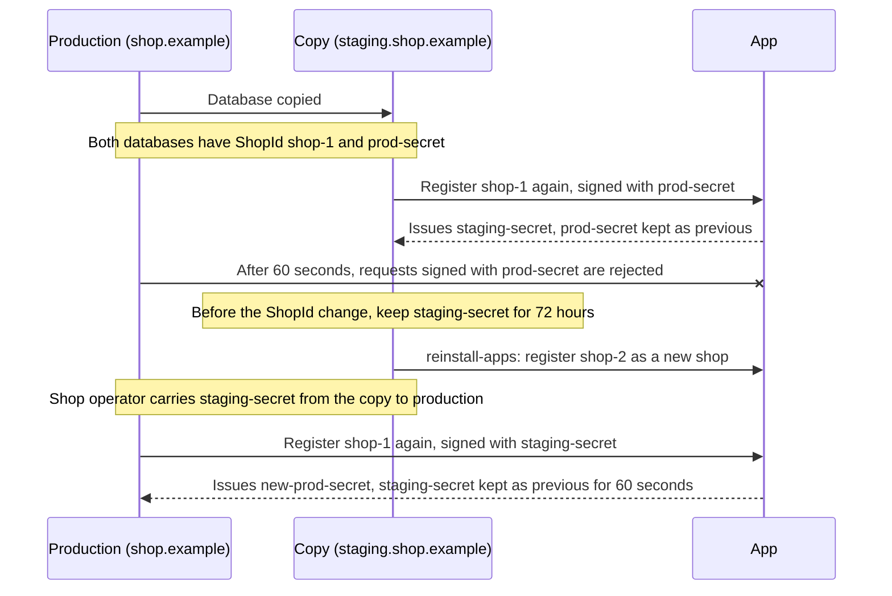

# Recover app connections when a staging copy took over production

## Context

A Shopware instance identifies itself to apps by its ShopId, an ID string stored in its database, and signs requests with a secret that only it and the app know.
A registration is the exchange in which the shop and the app agree a new secret: the shop sends a first request, the app answers with the new secret, and the shop confirms.
Each registration replaces the previous secret.
The app's server, run by the app operator, keeps one record per ShopId with the current secret and the [previous one](https://github.com/shopware/app-php-sdk/blob/976bd3a993619ac80482d630ca312020033552ad/src/Registration/RegistrationService.php#L186-L189).

A copy of the shop database inherits the ShopId and the secrets.
If the copy registers its apps again under that ShopId, it takes over production (the live shop): the apps now only talk to the copy, and production can no longer communicate with them, without being told why.

Running example: production, the live shop, runs at `https://shop.example` with the secret `prod-secret`, and its shop operator copies the database to a staging shop for testing at `https://staging.shop.example`.
The app keeps a record for production under the ShopId `shop-1`.
`staging-secret` is the secret the copy gets when it takes over; `new-prod-secret` is the one production gets back.

### How it happens

When a shop runs at a new URL, Shopware asks the operator in the Administration what to do.
"Move shop permanently" tells the apps "this is still the same shop, it just moved".
That's right when production really moves to a new server.
On a copy it's wrong, because the copy then takes over production's place at the apps.

Later the operator usually notices and fixes the copy with `reinstall-apps`, which registers the copy as a new, separate shop.
That doesn't help production: the apps still expect the secret the copy got during the takeover, and the copy has just thrown it away.
Nobody can talk to the apps as production any more.

### What it takes to get production back

Production has to register with the apps again, and the apps must only accept that from someone allowed to do it.

Production's old secret isn't proof enough.
Every copy and backup of the database has it too, and so does an old server left running after a real move.

The secret the copy got during the takeover is proof enough.
Only the copy has it, and apps already accept a new registration signed with it.
The copy just has to keep it long enough to hand it to production.

Today it doesn't keep it.
`reinstall-apps` replaces it, and `uninstall-apps` only keeps it until the next ShopId change.
That's why the [developer documentation](https://beta-developer.shopware.com/docs/guides/plugins/apps/lifecycle/app-secret-recovery.html) calls this case unrecoverable.

## Decision

1. Before a shop gets a new ShopId, or removes its apps, it keeps the secrets its apps currently accept, for 72 hours.
   It only does this after "Move shop permanently", which is how a copy takes over production.
2. The shop operator takes them from the copy to production, and production registers again with them.
3. The app protocol does not change: apps already accept a registration signed with their current secret.
4. If the copy no longer has the secret (it was deleted, or more than 72 hours have passed), the app operator checks with the shop operator which instance is the real shop and resets the registration by hand, as today.

The process in short:

1. The copy picks "Move shop permanently", and the app switches `shop-1` to `staging-secret`.
2. Before the copy gets a new ShopId, for example with `reinstall-apps`, it keeps `staging-secret` for 72 hours.
3. The shop operator prints `staging-secret` on the copy and passes it to production.
4. Production registers again as `shop-1`, signed with `staging-secret`.
5. The app accepts it like any registration and gives production `new-prod-secret`.
   Production is no longer locked out.

### Keeping the secret

Getting a new ShopId or removing its apps is the last moment the copy still holds the secret production needs.

The copy can't see whether it took over production.
It only knows that "Move shop permanently" ran, so it assumes it took over and keeps the secrets for 72 hours as a safeguard.
It knows from the ShopId check, which compares the stored APP_URL, installation path and sales channel domains with the running shop:

- After "Move shop permanently", staging has its own details stored, like `https://staging.shop.example`, so the check passes and it keeps the secret.
- A fresh copy still has production's details stored, like `https://shop.example`, so the check fails and it keeps nothing.

For each app, the copy keeps its current secret.
If a registration broke off halfway, it also keeps the secret from that attempt, since the app may already expect it.

In the example, the copy stores one row like this per app in its own database:

| Field   | Value                                     |
|:--------|:------------------------------------------|
| ShopId  | `shop-1`                                  |
| App     | the app it belongs to; each app has its own secrets |
| Secret  | `staging-secret`                          |
| Expires | 72 hours after the ShopId change, then deleted |

### Handing it over

On the copy, `app:secret:recover --list <app-name>` prints every secret the copy holds for that app, newest first, with their ShopId and expiry.
`app:secret:recover --start <app-name>` prints only the ones production needs, as JSON.
With `--all` instead of `<app-name>`, it does this for every app at once, so the JSON names the app for each secret.
Which secret that is depends on what happened on the copy:

- If the copy never registered again, it still has production's secret, copied over with the database.
- If the copy moved permanently, it has the new secret the app generated then. It still has it after `reinstall-apps`, because it kept it for 72 hours.

On production, `app:secret:recover --finish` reads that JSON when it is pasted or piped in, never from the command line, so they stay out of the shell history.
For each app, it registers again, signed with each secret in turn, newest first, and stops at the first one the app accepts.
Production gets a new secret, and the copy's secret stops working.

Moving the secrets from the copy to production safely, for example through a password manager and not through chat or email, is the shop operator's job.

## Alternatives

| Option | Why not |
|:---|:---|
| Accept production's old secret | An old server still running after a real move has it too, and could take production's place back. |
| Accept any older secret the app has on record | Every copy and backup has older secrets, and the app can't see who holds them. |
| A recovery token: the copy signs a short note with its secret, and production sends it along when it registers | Every app would have to update its SDK first, and it adds a new way for an app to accept an old secret. Tokens apps already get from shops are signed the same way, so they could pass as a recovery token. |
| The copy tells the app with a webhook when it gets a new ShopId | The app has to store every message and judge it by the URLs each shop reports about itself. |
| Keep nothing, print the copy's secret when needed | Only works before the copy runs `reinstall-apps`. After that the secret is gone. |
| The copy names production's ShopId when it registers as a new shop | `uninstall-apps` and `system:setup:staging` without `--reinstall-apps` don't register at all. The extra field would also break every deployed app, because the SDK only checks [part of the signed request](https://github.com/shopware/app-php-sdk/blob/976bd3a993619ac80482d630ca312020033552ad/src/Authentication/RequestVerifier.php#L192-L199). |
| Store the shop's identity outside the database | It can be copied too, and it can't undo a takeover that already happened. |
| Store app data by ShopId and URL together | Changes how app data is stored and how real moves work, and copies can share a URL. |
| Recover through `app:secret:rotate --adopt-secrets` | Mixes two jobs in one command: giving the shop a new secret, and registering with a secret from another shop. |
| Name the commands `--release` (on the copy) and `--claim` (on production) | Still open. They say that the registration changes hands, where `--start` and `--finish` only say the order. |
| Manual recovery only | Every takeover would need support work. It stays as the fallback. |
| **Keep the copy's secret for 72 hours and hand it to production, manual otherwise (chosen)** | |

## Consequences

### Positive

- Production can get its apps back without support work, even after the copy ran `reinstall-apps`.
- It works with every app today, without an SDK update.
- Apps don't have to trust anything new: production registers with a secret the apps already accept.
- It doesn't rely on URLs, so real moves to a new URL keep working as before.

### Negative

- **The copy keeps a working secret for up to 72 hours after it gets a new ShopId.**
- **The secret has to travel from the copy to production.**
  Anyone who intercepts it can take over production's place at the apps, until production has registered again.
- **The copy's secret still works for 60 seconds after recovery.**
  The app SDKs accept a replaced secret for that long.

### Limitations

- **72 hours.**
  The copy keeps the secret for 72 hours after it gets a new ShopId or removes its apps.
  After that, or if the copy is deleted first, only manual recovery is left.
- **A copy that moves again keeps nothing.**
  If the copy moves to another URL or directory after "Move shop permanently", the ShopId check fails, so it keeps no secrets.
  Production then needs manual recovery.
- **Production isn't told.**
  Nothing tells production it was locked out.
  Its shop operator has to notice and start the recovery.
- **Takeovers aren't prevented.**
  A staging copy can still take over production.
  This only undoes the takeover afterwards.

## References

- [APP URL verification](2026-03-18-app-url-verify-utils.md): limits of detecting copies.
- [App secret rotation and recovery](https://beta-developer.shopware.com/docs/guides/plugins/apps/lifecycle/app-secret-recovery.html): recovery after credentials diverge.
