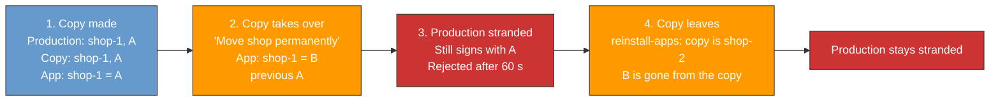
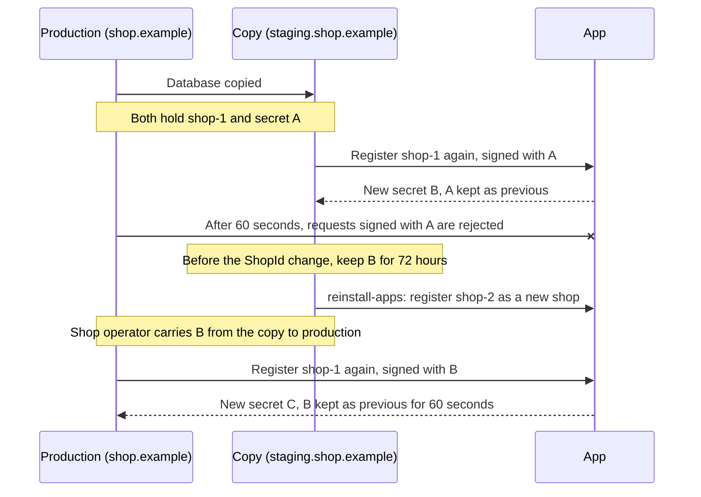

# Give app registrations back after a shop copy took them over

> When a copy of a shop takes over the shop's registrations with apps, the copy keeps its newest app secrets for 72 hours, even after it gets a new ShopId.
> The shop operator hands them to the original shop, which registers with the app again, signed with them.
> Every app already accepts such a registration, and every other case is a manual decision by the app operator.

## Context

A Shopware instance identifies itself to apps by its ShopId, an ID string stored in its database, and signs requests with a secret that only it and the app know.
A registration is the exchange in which the shop and the app agree a new secret: the shop sends a first request, the app answers with the new secret, and the shop confirms.
Each registration replaces the previous secret.
The app's server, run by the app operator, keeps one record per ShopId with the current secret and the [previous one](https://github.com/shopware/app-php-sdk/blob/976bd3a993619ac80482d630ca312020033552ad/src/Registration/RegistrationService.php#L186-L189).

A copy of the shop database inherits the ShopId and the secrets.
If the copy registers apps again under that ShopId, it takes the shop over: the app switches to a new secret and the original shop is stranded.
Once the app stops accepting the old secret, the original shop's requests are rejected and nothing tells it why.

Running example: production, the live shop, runs at `https://shop.example` with secret A, and its shop operator copies the database to a staging shop for testing at `https://staging.shop.example`.
B is the secret the copy gets when it takes over; C is the one production gets back.

When Shopware notices it runs at a new URL, it asks the shop operator in the Administration what to do.
"Move shop permanently" keeps the ShopId and registers every app again.
That is right when production really moves to a new server, and wrong on a copy, where it takes the ShopId from production.
Shopware's app SDKs, the libraries most apps use to talk to shops, accept the previous secret only for a [60-second grace period](https://github.com/shopware/app-php-sdk/blob/976bd3a993619ac80482d630ca312020033552ad/src/Authentication/DualSignatureRequestVerifier.php#L20) after a change.
`reinstall-apps` gives the copy a new ShopId and registers it with the app as a new shop with its own secret.
B is then gone from the copy, while the app's `shop-1` record stays on B, so nobody can sign as `shop-1` any more.

Shop operators control their copies.
Staging instructions and Shopware's copy detection, which compares the stored URL and domains with the current ones, help but cannot guarantee that a copy leaves its ShopId before it does damage.
Apps need a safe way to undo a takeover after it happened.

An old secret on its own cannot show which instance should own the ShopId:

- The copy holds the same old secrets as production.
- Running `system:setup:staging` on a new copy, the correct way to set up staging, also leaves the ShopId.
- When production moves to a new server, the old server often keeps running with the older secret.

The newest secret can.
Only the instance that took the ShopId over holds B, and every app already accepts a registration signed with it.
Today the copy loses B as soon as it gets a new ShopId or removes its apps:

- `reinstall-apps` replaces it with the new ShopId's secret.
- `system:setup:staging` deletes the app records.
- `uninstall-apps` keeps it in a list of deleted apps only until the next ShopId change.

That is why the [developer documentation](https://beta-developer.shopware.com/docs/guides/plugins/apps/lifecycle/app-secret-recovery.html) calls this case unrecoverable today.

## Decision

1. Right before Shopware deletes its ShopId, it keeps, in its own database for 72 hours, every secret each app may currently accept.
   It does so only while its ShopId check passes: the stored URL and domains still match the ones it runs at.
2. `app:secret:recoverable` on the copy prints these secrets, and `app:secret:rotate`, which runs a registration again, uses them on production.
3. The app sees an ordinary registration signed with its current secret.
   Apps and app SDKs do not change.
4. Every other case is a manual decision by the app operator.

The process in short:

1. A staging copy takes over the shop, and the app switches to secret B.
2. Before the copy gets a new ShopId, Shopware keeps B for 72 hours.
3. The shop operator prints B on the copy and passes it to a command on production.
4. Production registers again, signed with B.
5. The app accepts it like any registration and gives production a new secret C.

### Keeping the secret

Shopware keeps the secrets right before any of `reinstall-apps`, `uninstall-apps` and `system:setup:staging` [deletes its ShopId](../src/Core/Framework/App/ShopId/ShopIdProvider.php#L73).
That is the last moment the copy still holds B, however long ago the takeover was.
Today `system:setup:staging` deletes the app records, which hold B, before the ShopId ([`StagingAppHandler`](../src/Core/Maintenance/Staging/Handler/StagingAppHandler.php#L22-L27)).
This decision changes it to delete the ShopId first.

Shopware keeps them only while its ShopId check passes, the same condition a takeover needs.
A copy that took over passes it, because "Move shop permanently" stored the copy's own URL.
A new copy that never took over still has production's URL stored, fails the check and keeps nothing, so a normal staging setup does not store production's secret A for no reason.

For each app it keeps the current secret, plus any new secret the app may already use although the copy never got the app's answer to its confirmation.
That covers a takeover whose last answer from the app was lost on the way.

In the example, the copy stores one row like this per app in its own database:

| Field   | Value                                     |
|:--------|:------------------------------------------|
| ShopId  | `shop-1`                                  |
| App     | the app it belongs to; each app has its own secrets |
| Secret  | B                                         |
| Expires | 72 hours after the ShopId change          |

Shopware deletes kept secrets once they expire, in the existing daily app clean-up job and whenever it reads or stores kept secrets.
A copy where scheduled jobs never run keeps them until one of the two commands below runs.

While the copy still has the ShopId `shop-1`, nothing extra is kept: `app:secret:recoverable` reads B from the copy's own app record.

### Handing it over

On the copy, `app:secret:recoverable <app-name>` prints the secrets the copy holds for that app, newest first, with their ShopId and expiry.
With `--raw` it prints only the secrets, one per line.

On production, `app:secret:rotate <app-name> --adopt-secrets` reads those secrets when they are pasted or piped in, never from the command line, so they stay out of the shell history.
It signs a registration with each of them, newest first, before trying production's own secrets, and stops at the first one the app accepts.
From there it is the [existing rotation](../src/Core/Framework/App/Lifecycle/AppSecretRotationService.php#L140): production gets C, and B stops working after the 60-second grace period.

Moving the secret from the copy to production safely, for example through a password manager and not through chat or email, is the shop operator's job.

### Does the app accept the registration?

| Who registers as `shop-1`                           | Result                                        |
|:----------------------------------------------------|:----------------------------------------------|
| Production, given B                                 | Accepted                                      |
| Production, holding only A                          | Rejected: the app accepts only B              |
| An old backup holding the secret before A           | Rejected                                      |
| An old server left running after a planned move     | Rejected: it holds only older secrets         |
| Production, after the copy ran `app:secret:rotate` again | Accepted, if it is given the newest secret |
| Production, more than 72 hours after the copy got a new ShopId | The copy deleted B, so there is nothing to pass on; see manual recovery |
| Anyone given B                                      | Accepted, see the limitations                 |

The app does nothing new.
It accepts the registration for the same reason it accepts any request: it is signed with the secret the app issued last.

### Manual recovery

Outside these cases, the app operator decides.
Manual recovery is a planned, separate SDK feature, off by default.
It needs the app to keep more than the current and previous secret, which apps do not do today.
The app operator first confirms with the shop operator, through a channel the app already trusts, which instance is the real shop and at which URL it runs.
The app operator then creates a one-time approval in the app's admin tool that names:

- the ShopId,
- that confirmed shop URL,
- the old secret the shop must prove, chosen from the secrets the app recorded for that ShopId, however many changes old.

The approval expires after a short time, and the first registration that matches all three uses it up.
Production then runs `app:secret:rotate`, which signs its registration with that old secret, and recovery ends as in the case above.

## Alternatives

| Option | Why not |
|:---|:---|
| Accept the previous secret on its own | An old server left running after a move takes the ShopId back from the new server, because nothing shows that the current owner agreed. |
| Accept any older secret the app recorded | The older the accepted secret, the more copies and backups hold it, and the app cannot see any of them. |
| A recovery token: a short-lived note the copy signs with B, which production brings along with a registration signed with A | Every app must update its SDK before it helps, and it adds a new way for an app to accept an older secret. The tokens Shopware's Store API already gives apps are signed with the same secret and passed the app's checks for that note. |
| A message (webhook) the copy sends the app when it gets a new ShopId | The app has to store each message, and its checks rest on URLs each instance reports about itself. A message sent again after the copy registers again may be signed with its new secret. |
| Print B from the copy when needed, keep nothing | Only works if the shop operator runs it before the copy gets a new ShopId. After copy, takeover, `reinstall-apps`, B is already gone. |
| Put the old ShopId in the new ShopId's registration | `uninstall-apps` and `system:setup:staging` never register again. A new field also breaks every deployed app: Shopware signs the whole registration URL, but the SDK checks the signature against [only three of its fields](https://github.com/shopware/app-php-sdk/blob/976bd3a993619ac80482d630ca312020033552ad/src/Authentication/RequestVerifier.php#L192-L199). |
| Keep the shop identity outside the copied database | Can itself be copied, and does not repair a takeover that already happened. |
| Store app data by ShopId and URL together | Changes storage and how legitimate moves work, and copies can share a URL. |
| A new scheduled job to delete expired secrets | The existing daily app clean-up job already removes retired credentials. |
| Manual recovery only | Every takeover needs support work. It stays as the fallback. |
| **Keep B for 72 hours, hand it over, manual otherwise (chosen)** | |

## Consequences

### Positive

- A single takeover by a copy can be undone without support work, even after the copy changed its ShopId.
- It works with every app today: no SDK update and no opt-in.
- Apps gain no new way to accept a secret: recovery is a registration they already accept from the current owner.
- The proof is the current secret, not URLs, so legitimate URL changes stay safe.

### Negative

- **A working secret stays on the copy after it gets a new ShopId.**
  For up to 72 hours, and longer on a copy where scheduled jobs never run and neither command is used.
- **The shop operator passes on a full secret.**
  Whoever holds it can act as `shop-1` until production registers again and the app issues C.
- **The app still accepts B for 60 seconds after recovery.**
  That is the SDK's grace period for a replaced secret.
- **Recovery strands a copy that is still `shop-1`.**
  Such a copy needs `reinstall-apps` before it can talk to the app again.

### Limitations

- **Whoever holds B can act as `shop-1`.**
  This is already true today.
  Passing B on moves that ability from the copy to production; it does not create it.
- **72 hours.**
  They start when the copy deleted its ShopId.
  After it, or if the copy is destroyed first, only manual recovery is left.
- **Production is not told.**
  Neither Shopware nor the app tells production it was locked out.
  Its shop operator has to notice and run `app:secret:rotate`.
- **Takeovers are not prevented.**
  A staging copy can still take over production's registration.
  This design undoes one takeover afterwards.

### Must ship together

- **Shopware:**
  - keep the secrets right before the ShopId is deleted, only while the ShopId check passes;
  - `system:setup:staging` deletes the ShopId before the app records;
  - delete kept secrets after 72 hours;
  - `app:secret:recoverable`;
  - `--adopt-secrets` on `app:secret:rotate`.
- **Developer documentation:** replace "unrecoverable" with the handover steps, and state that the shop operators move the secret.
- **App SDKs:** nothing for this case.
  Manual recovery stays a separate, optional SDK feature.

## References

- [APP URL verification](2026-03-18-app-url-verify-utils.md): limits of detecting copies.
- [App secret rotation and recovery](https://beta-developer.shopware.com/docs/guides/plugins/apps/lifecycle/app-secret-recovery.html): recovery after credentials diverge.

> The current secret shows who owns the ShopId.
> Hand it over, and the original shop registers again with it.
> Everything else needs an approval that names the shop.
