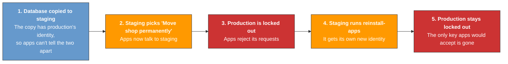
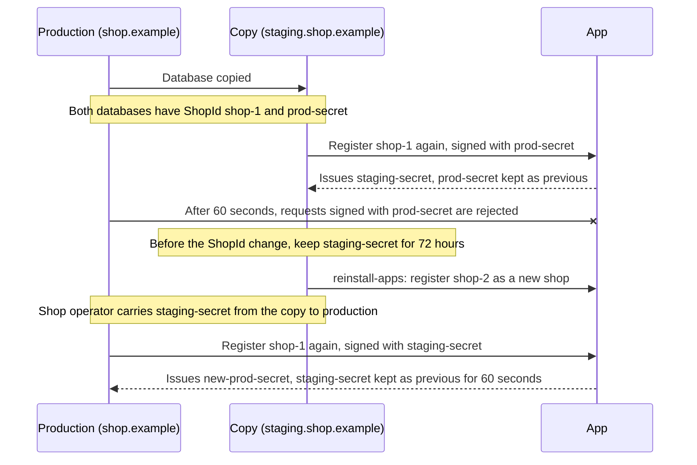

# Recover app connections when a staging copy took over production

## Context

A Shopware instance identifies itself to apps by its ShopId, an ID string stored in its database, and signs requests with a secret that only it and the app know.
A registration is the exchange in which the shop and the app agree a new secret: the shop sends a first request, the app answers with the new secret, and the shop confirms.
Each registration replaces the previous secret.
The app's server, run by the app operator, keeps one record per ShopId with the current secret and the [previous one](https://github.com/shopware/app-php-sdk/blob/976bd3a993619ac80482d630ca312020033552ad/src/Registration/RegistrationService.php#L186-L189).

A copy of the shop database inherits the ShopId and the secrets.
If the copy registers its apps again under that ShopId, it takes over production (the live shop): the apps now only talk to the copy, and production can no longer communicate with them, without being told why.

Running example: production, the live shop, runs at `https://shop.example` with the secret `prod-secret`, and its shop operator copies the database to a staging shop for testing at `https://staging.shop.example`.
The app keeps a record for production under the ShopId `shop-1`.
`staging-secret` is the secret the copy gets when it takes over; `new-prod-secret` is the one production gets back.

### How it happens

When a shop runs at a new URL, Shopware asks the operator in the Administration what to do.
"Move shop permanently" tells the apps "this is still the same shop, it just moved".
That's right when production really moves to a new server.
On a copy it's wrong, because the copy then takes over production's place at the apps.

Later the operator usually notices and fixes the copy with `reinstall-apps`, which registers the copy as a new, separate shop.
That doesn't help production: the apps still expect the secret the copy got during the takeover, and the copy has just thrown it away.
Nobody can talk to the apps as production any more.

### What it takes to get production back

Production has to register with the apps again, and the apps must only accept that from someone allowed to do it.

Production's old secret isn't proof enough.
Every copy and backup of the database has it too, and so does an old server left running after a real move.

The secret the copy got during the takeover is proof enough.
Only the copy has it, and apps already accept a new registration signed with it.
The copy just has to keep it long enough to hand it to production.

Today it doesn't keep it.
`reinstall-apps` replaces it, and `uninstall-apps` only keeps it until the next ShopId change.
That's why the [developer documentation](https://beta-developer.shopware.com/docs/guides/plugins/apps/lifecycle/app-secret-recovery.html) calls this case unrecoverable.

## Decision

1. Before a shop gets a new ShopId, or removes its apps, it keeps the secrets its apps currently accept, for 72 hours.
   It only does this if it took over production.
2. The shop operator takes them from the copy to production, and production registers again with them.
3. The app protocol does not change: apps already accept a registration signed with their current secret.
4. If the copy no longer has the secret (it was deleted, or more than 72 hours have passed), the app operator resets the registration by hand, as today.

The process in short:

1. The copy picks "Move shop permanently", and the app switches `shop-1` to `staging-secret`.
2. Before the copy gets a new ShopId, for example with `reinstall-apps`, it keeps `staging-secret` for 72 hours.
3. The shop operator prints `staging-secret` on the copy and passes it to production.
4. Production registers again as `shop-1`, signed with `staging-secret`.
5. The app accepts it like any registration and gives production `new-prod-secret`.
   Production is no longer locked out.

### Keeping the secret

Getting a new ShopId or removing its apps is the last moment the copy still holds the secret production needs.

The copy only keeps secrets if it took over production. It can tell from the shop URL it has stored as its own:

- After "Move shop permanently", staging has `https://staging.shop.example` stored, which is where it runs. It took over, so it keeps the secret.
- A fresh copy still has production's `https://shop.example` stored. It never took over, so it keeps nothing.

For each app, the copy keeps its current secret.
If a registration broke off halfway, it also keeps the secret from that attempt, since the app may already expect it.

In the example, the copy stores one row like this per app in its own database:

| Field   | Value                                     |
|:--------|:------------------------------------------|
| ShopId  | `shop-1`                                  |
| App     | the app it belongs to; each app has its own secrets |
| Secret  | `staging-secret`                          |
| Expires | 72 hours after the ShopId change, then deleted |

### Handing it over

On the copy, `app:secret:recover --list <app-name>` prints every secret the copy holds for that app, newest first, with their ShopId and expiry.
`app:secret:recover --start <app-name>` prints only the ones production needs, as JSON with the app name for each secret.
Which secret that is depends on what happened on the copy:

- If the copy never registered again, it still has production's secret, copied over with the database.
- If the copy took over, it has the new secret the app generated then. It still has it after `reinstall-apps`, because it kept it for 72 hours.

The command can recover all apps at once with `--all`, or a single app with `<app-name>`.

On production, `app:secret:recover --finish` reads that JSON when it is pasted or piped in, never from the command line, so they stay out of the shell history.
For each app, it registers again, signed with each secret in turn, newest first, and stops at the first one the app accepts.
Production gets a new secret, and the copy's secret stops working.

Moving the secrets from the copy to production safely, for example through a password manager and not through chat or email, is the shop operator's job.

### Does the app accept the registration?

| Who registers as `shop-1`                           | Result                                        |
|:----------------------------------------------------|:----------------------------------------------|
| Production, given `staging-secret`                  | Accepted                                      |
| Production, holding only `prod-secret`              | Rejected: the app accepts only `staging-secret` |
| Production, more than 72 hours after the copy got a new ShopId | The copy deleted `staging-secret`, so there is nothing to pass on; see manual recovery |

### Manual recovery

Every other case stays with the app operator, as today.
They confirm with the shop operator which instance is the real shop, and reset the registration by hand.
Support for this in the app SDKs is not part of this decision.

## Alternatives

| Option | Why not |
|:---|:---|
| Accept the previous secret on its own | An old server left running after a move takes the ShopId back from the new server, because nothing shows that the current owner agreed. |
| Accept any older secret the app recorded | The older the accepted secret, the more copies and backups hold it, and the app cannot see any of them. |
| A recovery token: a short-lived note the copy signs with `staging-secret`, which production brings along with a registration signed with `prod-secret` | Every app must update its SDK before it helps, and it adds a new way for an app to accept an older secret. The tokens Shopware's Store API already gives apps are signed with the same secret and passed the app's checks for that note. |
| A message (webhook) the copy sends the app when it gets a new ShopId | The app has to store each message, and its checks rest on URLs each instance reports about itself. A message sent again after the copy registers again may be signed with its new secret. |
| Print `staging-secret` from the copy when needed, keep nothing | Only works if the shop operator runs it before the copy gets a new ShopId. After copy, takeover, `reinstall-apps`, `staging-secret` is already gone. |
| Put the old ShopId in the new ShopId's registration | `uninstall-apps` and `system:setup:staging` never register again. A new field also breaks every deployed app: Shopware signs the whole registration URL, but the SDK checks the signature against [only three of its fields](https://github.com/shopware/app-php-sdk/blob/976bd3a993619ac80482d630ca312020033552ad/src/Authentication/RequestVerifier.php#L192-L199). |
| Keep the shop identity outside the copied database | Can itself be copied, and does not repair a takeover that already happened. |
| Store app data by ShopId and URL together | Changes storage and how legitimate moves work, and copies can share a URL. |
| Recover with `app:secret:rotate --adopt-secrets` | Mixes two jobs in one command: replacing the shop's own secret, and registering with secrets handed over from another shop. |
| Name the steps `--release` (on the copy) and `--claim` (on production) instead of `--start` and `--finish` | Open. They say that the registration changes hands, where `--start` and `--finish` only say the order. |
| Manual recovery only | Every takeover needs support work. It stays as the fallback. |
| **Keep `staging-secret` for 72 hours, hand it over, manual otherwise (chosen)** | |

## Consequences

### Positive

- A single takeover by a copy can be undone without support work, even after the copy changed its ShopId.
- It works with every app today: no SDK update and no opt-in.
- Apps gain no new way to accept a secret: recovery is a registration they already accept from the current owner.
- The proof is the current secret, not URLs, so legitimate URL changes stay safe.

### Negative

- **A working secret stays on the copy after it gets a new ShopId.**
  For up to 72 hours.
- **The secret travels from the copy to production.**
  Anyone who gets it on the way can take over `shop-1`, until production has registered again.
- **The app still accepts `staging-secret` for 60 seconds after recovery.**
  That is the SDK's grace period for a replaced secret.
- **Recovery strands a copy that is still `shop-1`.**
  Such a copy needs `reinstall-apps` before it can talk to the app again.

### Limitations

- **72 hours.**
  They start when the copy got a new ShopId or removed its apps.
  After it, or if the copy is destroyed first, only manual recovery is left.
- **A copy that moves again keeps nothing.**
  If the copy moves to another URL or directory after the takeover, its stored URL and directory no longer match where it runs, so it keeps no secrets.
  Production then needs manual recovery.
- **Production is not told.**
  Neither Shopware nor the app tells production it was locked out.
  Its shop operator has to notice and start the recovery.
- **Takeovers are not prevented.**
  A staging copy can still take over production's registration.
  This design undoes one takeover afterwards.

## References

- [APP URL verification](2026-03-18-app-url-verify-utils.md): limits of detecting copies.
- [App secret rotation and recovery](https://beta-developer.shopware.com/docs/guides/plugins/apps/lifecycle/app-secret-recovery.html): recovery after credentials diverge.
