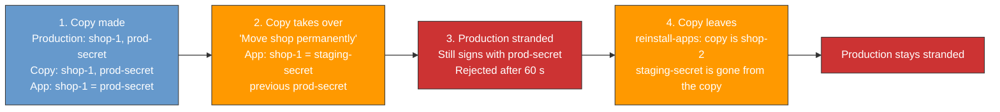
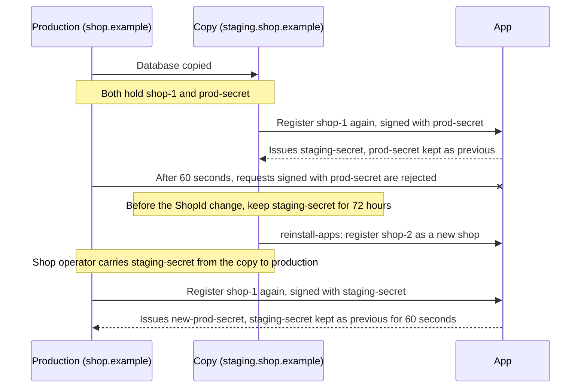

# Give app registrations back after a shop copy took them over

## Context

A Shopware instance identifies itself to apps by its ShopId, an ID string stored in its database, and signs requests with a secret that only it and the app know.
A registration is the exchange in which the shop and the app agree a new secret: the shop sends a first request, the app answers with the new secret, and the shop confirms.
Each registration replaces the previous secret.
The app's server, run by the app operator, keeps one record per ShopId with the current secret and the [previous one](https://github.com/shopware/app-php-sdk/blob/976bd3a993619ac80482d630ca312020033552ad/src/Registration/RegistrationService.php#L186-L189).

A copy of the shop database inherits the ShopId and the secrets.
If the copy registers apps again under that ShopId, it takes the shop over: the app switches to a new secret and the original shop is stranded.
Once the app stops accepting the old secret, the original shop's requests are rejected and nothing tells it why.

Running example: production, the live shop, runs at `https://shop.example` with the secret `prod-secret`, and its shop operator copies the database to a staging shop for testing at `https://staging.shop.example`.
`staging-secret` is the secret the copy gets when it takes over; `new-prod-secret` is the one production gets back.

When Shopware notices it runs at a new URL, it asks the shop operator in the Administration what to do.
"Move shop permanently" keeps the ShopId and registers every app again.
That is right when production really moves to a new server, and wrong on a copy, where it takes the ShopId from production.
Shopware's app SDKs, the libraries most apps use to talk to shops, accept the previous secret only for a [60-second grace period](https://github.com/shopware/app-php-sdk/blob/976bd3a993619ac80482d630ca312020033552ad/src/Authentication/DualSignatureRequestVerifier.php#L20) after a change.
`reinstall-apps` gives the copy a new ShopId and registers it with the app as a new shop with its own secret.
`staging-secret` is then gone from the copy, while the app's `shop-1` record stays on `staging-secret`, so nobody can sign as `shop-1` any more.

Shop operators control their copies.
Staging instructions and Shopware's copy detection, which compares the shop's fingerprints (APP_URL, installation path, sales channel domains) with the current ones, help but cannot guarantee that a copy leaves its ShopId before it does damage.
Apps need a safe way to undo a takeover after it happened.

An old secret on its own cannot show which instance should own the ShopId:

- The copy holds the same old secrets as production.
- Running `system:setup:staging` on a new copy, the correct way to set up staging, also leaves the ShopId.
- When production moves to a new server, the old server often keeps running with the older secret.

The newest secret can.
Only the instance that took the ShopId over holds `staging-secret`, and every app already accepts a registration signed with it.
Today the copy loses `staging-secret` as soon as it gets a new ShopId or removes its apps:

- `reinstall-apps` replaces it with the new ShopId's secret.
- `uninstall-apps` keeps it in a list of deleted apps only until the next ShopId change.

That is why the [developer documentation](https://beta-developer.shopware.com/docs/guides/plugins/apps/lifecycle/app-secret-recovery.html) calls this case unrecoverable today.

## Decision

1. Before a shop gets a new ShopId, or removes its apps, it keeps the secrets its apps currently accept, for 72 hours.
   It only does this while its fingerprints still match.
2. The shop operator takes them from the copy to production, and production registers again with them.
3. Apps don't change: they already accept a registration signed with their current secret.
4. Every other case is a manual decision by the app operator.

The process in short:

1. A staging copy takes over the shop, and the app switches to `staging-secret`.
2. Before the copy gets a new ShopId, Shopware keeps `staging-secret` for 72 hours.
3. The shop operator prints `staging-secret` on the copy and passes it to a command on production.
4. Production registers again, signed with `staging-secret`.
5. The app accepts it like any registration and gives production `new-prod-secret`.

### Keeping the secret

Getting a new ShopId or removing its apps is the last moment the copy still holds the secret production needs.

A copy that took over keeps the secrets: "Move shop permanently" updated its fingerprints to the copy's own URL, so they match where it runs.
A fresh copy still has production's fingerprints, which don't match where it runs, so it keeps nothing.

For each app, the copy keeps its current secret, and also the secret from any registration that did not finish, because the app may already use it.

In the example, the copy stores one row like this per app in its own database:

| Field   | Value                                     |
|:--------|:------------------------------------------|
| ShopId  | `shop-1`                                  |
| App     | the app it belongs to; each app has its own secrets |
| Secret  | `staging-secret`                          |
| Expires | 72 hours after the ShopId change          |

Instead of a table only for this case, this work could add a general history of each app's secrets.

Shopware deletes kept secrets once they expire.

Production can also be recovered before the copy gets a new ShopId.
The secret is then still in the copy's normal app data, and the copy prints it from there.

### Handing it over

On the copy, `app:secret:recover --list <app-name>` prints every secret the copy holds for that app, newest first, with their ShopId and expiry.
`app:secret:recover --start <app-name>` prints only the ones production needs, one per line with the app name in front.
If the copy kept secrets before it got a new ShopId, those are the kept ones; otherwise they are the secrets it currently uses.
Both take `--all` instead of an app name.

On production, `app:secret:recover --finish` reads those lines when they are pasted or piped in, never from the command line, so they stay out of the shell history.
For each app, it registers again, signed with each secret in turn, newest first, and stops at the first one the app accepts.
Production gets a new secret, and the copy's secret stops working after the 60-second grace period.

Moving the secrets from the copy to production safely, for example through a password manager and not through chat or email, is the shop operator's job.

### Does the app accept the registration?

| Who registers as `shop-1`                           | Result                                        |
|:----------------------------------------------------|:----------------------------------------------|
| Production, given `staging-secret`                  | Accepted                                      |
| Production, holding only `prod-secret`              | Rejected: the app accepts only `staging-secret` |
| An old backup holding the secret before `prod-secret` | Rejected                                    |
| An old server left running after a planned move     | Rejected: it holds only older secrets         |
| Production, after the copy ran `app:secret:rotate` again | Accepted, if it is given the newest secret |
| Production, more than 72 hours after the copy got a new ShopId | The copy deleted `staging-secret`, so there is nothing to pass on; see manual recovery |
| Anyone given `staging-secret`                       | Accepted, see the limitations                 |

The app does nothing new.
It accepts the registration for the same reason it accepts any request: it is signed with the secret the app issued last.

### Manual recovery

Every other case stays with the app operator, as today.
They confirm with the shop operator which instance is the real shop, and reset the registration by hand.
Support for this in the app SDKs is not part of this decision.

## Alternatives

| Option | Why not |
|:---|:---|
| Accept the previous secret on its own | An old server left running after a move takes the ShopId back from the new server, because nothing shows that the current owner agreed. |
| Accept any older secret the app recorded | The older the accepted secret, the more copies and backups hold it, and the app cannot see any of them. |
| A recovery token: a short-lived note the copy signs with `staging-secret`, which production brings along with a registration signed with `prod-secret` | Every app must update its SDK before it helps, and it adds a new way for an app to accept an older secret. The tokens Shopware's Store API already gives apps are signed with the same secret and passed the app's checks for that note. |
| A message (webhook) the copy sends the app when it gets a new ShopId | The app has to store each message, and its checks rest on URLs each instance reports about itself. A message sent again after the copy registers again may be signed with its new secret. |
| Print `staging-secret` from the copy when needed, keep nothing | Only works if the shop operator runs it before the copy gets a new ShopId. After copy, takeover, `reinstall-apps`, `staging-secret` is already gone. |
| Put the old ShopId in the new ShopId's registration | `uninstall-apps` and `system:setup:staging` never register again. A new field also breaks every deployed app: Shopware signs the whole registration URL, but the SDK checks the signature against [only three of its fields](https://github.com/shopware/app-php-sdk/blob/976bd3a993619ac80482d630ca312020033552ad/src/Authentication/RequestVerifier.php#L192-L199). |
| Keep the shop identity outside the copied database | Can itself be copied, and does not repair a takeover that already happened. |
| Store app data by ShopId and URL together | Changes storage and how legitimate moves work, and copies can share a URL. |
| Recover with `app:secret:rotate --adopt-secrets` | Mixes two jobs in one command: replacing the shop's own secret, and registering with secrets handed over from another shop. |
| Manual recovery only | Every takeover needs support work. It stays as the fallback. |
| **Keep `staging-secret` for 72 hours, hand it over, manual otherwise (chosen)** | |

## Consequences

### Positive

- A single takeover by a copy can be undone without support work, even after the copy changed its ShopId.
- It works with every app today: no SDK update and no opt-in.
- Apps gain no new way to accept a secret: recovery is a registration they already accept from the current owner.
- The proof is the current secret, not URLs, so legitimate URL changes stay safe.

### Negative

- **A working secret stays on the copy after it gets a new ShopId.**
  For up to 72 hours.
- **The shop operator passes on a full secret.**
  Whoever holds it can act as `shop-1` until production registers again and the app issues `new-prod-secret`.
- **The app still accepts `staging-secret` for 60 seconds after recovery.**
  That is the SDK's grace period for a replaced secret.
- **Recovery strands a copy that is still `shop-1`.**
  Such a copy needs `reinstall-apps` before it can talk to the app again.

### Limitations

- **Whoever holds `staging-secret` can act as `shop-1`.**
  This is already true today.
  Passing `staging-secret` on moves that ability from the copy to production; it does not create it.
- **72 hours.**
  They start when the copy got a new ShopId or removed its apps.
  After it, or if the copy is destroyed first, only manual recovery is left.
- **A copy that moves again keeps nothing.**
  If the copy gets a different APP_URL or installation directory after the takeover and before it gets a new ShopId, its fingerprints no longer match and it keeps no secrets.
  Production then needs manual recovery.
- **Production is not told.**
  Neither Shopware nor the app tells production it was locked out.
  Its shop operator has to notice and start the recovery.
- **Takeovers are not prevented.**
  A staging copy can still take over production's registration.
  This design undoes one takeover afterwards.

## References

- [APP URL verification](2026-03-18-app-url-verify-utils.md): limits of detecting copies.
- [App secret rotation and recovery](https://beta-developer.shopware.com/docs/guides/plugins/apps/lifecycle/app-secret-recovery.html): recovery after credentials diverge.
