# Limit damage to app relationships after shop cloning

> Record identity branches and retain old secrets so each app can choose when both proofs permit automatic recovery.

## Context

A shop copy inherits its ShopId and shared app secrets.
Reinstalling apps or rotating credentials while sharing that identity can replace the app's relationship with the live shop.

Shop owners control their copies.
Staging instructions and fingerprints help, but cannot guarantee when a copy becomes a separate instance.
Apps need a way to understand identity changes and recover an earlier relationship after the damage occurs.

## Decision

1. Notify subscribed apps when this instance leaves ShopId A for B, independently of registration.
2. Attempt synchronous delivery before replacing the identity or credentials.
   Report failures and continue separating the instances.
3. Recommend app-side secret history for recovery under an explicit policy chosen by the app owner.
4. Let each app enable automatic re-registration only when both matching authenticated lineage and proof of an eligible historical secret are present, subject to its custom policy.

### Record a branch without replacing the original relationship

The webhook carries the previous and replacement ShopIds, authenticated using the existing relationship.
Apps subscribe through the existing webhook mechanism and retain authenticated lineage alongside registration history.
No secrets are included in the payload, and registration gains no lineage fields.

Capture the previous identity and app relationship before deleting them.
The current [ShopId deletion](../src/Core/Framework/App/ShopId/ShopIdProvider.php#L73) clears that context; subscribing only to the later change event cannot recover it.

```mermaid
sequenceDiagram
    participant Production
    participant Copy as Staging copy
    participant App as App backend
    Note over Production,Copy: Both initially hold shop-1 and secret A
    Copy->>App: Re-register shop-1 and rotate to secret B
    Note over Production,App: App holds B as current and retains A as historical
    Copy->>App: Announce shop-1 to shop-2 signed with secret B
    Copy->>Copy: Adopt shop-2 even if notification failed
    Copy->>App: Register shop-2 through the existing handshake
    Production->>App: Re-register shop-1 with proof of secret A
    App->>App: Check matching lineage and historical-secret proof
    App-->>Production: Accept only if this app enables and permits recovery
```

Staging first takes over shop-1 with secret B.
After staging separates as shop-2, the app can allow production to re-register shop-1 using secret A, provided it holds matching authenticated lineage and its recovery policy permits the attempt.
A successful recovery establishes fresh credentials through normal registration.

The announcement preserves shop-1's relationship and data.
It does not activate shop-2 or prove the transition completed; normal registration establishes shop-2 separately.

A notification failure must not prevent separation or stop attempts for other subscribed apps.
Without recorded lineage, this automatic recovery path is unavailable.

### Retain proof under an app-owner recovery policy

Shopware's app-developer documentation should recommend retaining previous shared secrets with their ShopId, URL, and replacement time.
Protect this history like active secrets and exclude it from payloads and logs.

Automatic recovery requires explicit enablement per app, matching lineage already authenticated and recorded for that app and historical relationship, and valid proof of an eligible old secret.
A claim of lineage in the recovery request cannot supply its own authorization.
Neither evidence alone is sufficient.

The app owner supplies additional logic, such as accepting only the last secret, applying a time limit, or requiring successful registration of the replacement identity.
Explicit revocation takes precedence.
A disabled policy, missing lineage, or an ineligible secret denies automatic recovery; there is no automatic fallback to secret-only acceptance.

Recovery must not extend ordinary-request acceptance indefinitely.

## Alternatives

Ranks prioritize automatic recovery using both lineage and historical-secret proof, then scope and compatibility cost.

| Rank | Approach | Damage-control value | Cost or limitation |
|:---|:---|:---|:---|
| **1** | **Separate lineage webhook plus history — chosen** | **Both proofs for app-controlled automatic recovery** | **Identity capture, subscription, and app-side policy; missing delivery prevents this recovery path.** |
| 2 | Lineage in registration plus history | Both proofs for participating registrations | Preserves identity across deletion, extends registration flows and protocol, and requires app opt-in; no notice when no registration follows. |
| 3 | Secret history alone | Historical proof for another recovery policy | No lineage; does not satisfy the proposed automatic policy. |
| 4 | Manual recovery | Fallback when retained history is unavailable | Support effort and delay; independent evidence may be unavailable. |
| 5 | Identity outside the copied database | Distinguishes independently provisioned instances | Provisioning and migration burden; can itself be copied and does not repair an overwritten relationship. |
| 6 | ShopId and URL as storage keys | Separates some copies with different URLs | Changes storage and legitimate move handling; copies can share URLs. |
| 7 | Lineage webhook alone | Explains a branch when delivered | Event handling without recovery of authentication. |

Both lineage options require identity preservation and app adoption.
The separate webhook keeps those changes outside the registration handshake.
Requiring both proofs deliberately trades recovery availability for a stricter app-controlled acceptance policy.

## Consequences

### Positive

- Apps can connect old and new identities without extending registration.
- Apps can accept historical-secret re-registration after credentials were replaced when matching lineage is recorded.
- Each app controls whether automatic recovery is enabled and which additional rules apply.

### Negative and limitations

- Synchronous notification adds latency and may fail, including when the existing relationship can no longer authenticate it.
- An announcement can precede an incomplete transition.
  Apps must preserve the original relationship.
- Retained secrets require protected storage, retirement, and revocation handling.
  Both copies can possess old secrets and produce signed lineage; these checks do not independently establish which instance is the original.
- Apps without eligible history or recorded lineage, or with automatic recovery disabled, may require another recovery path or a new identity.
- Synchronous delivery is a webhook-system limitation: the pre-change identity and signing context must remain available through sending.
  The [delivery path resolves the signing secret at send time](../src/Core/Framework/Webhook/Service/WebhookSigningSecretResolver.php#L29).
  Asynchronous support is handled elsewhere; this ADR does not design or schedule it.

## References

- [APP URL verification](2026-03-18-app-url-verify-utils.md): limits of detecting copies.
- [App secret rotation and recovery](https://beta-developer.shopware.com/docs/guides/plugins/apps/lifecycle/app-secret-recovery.html): recovery after credentials diverge.

> A copy changing identity preserves the original relationship.
> Automatic recovery requires both authenticated lineage and historical-secret proof accepted by that app's policy.
