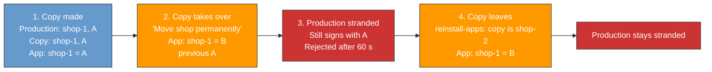
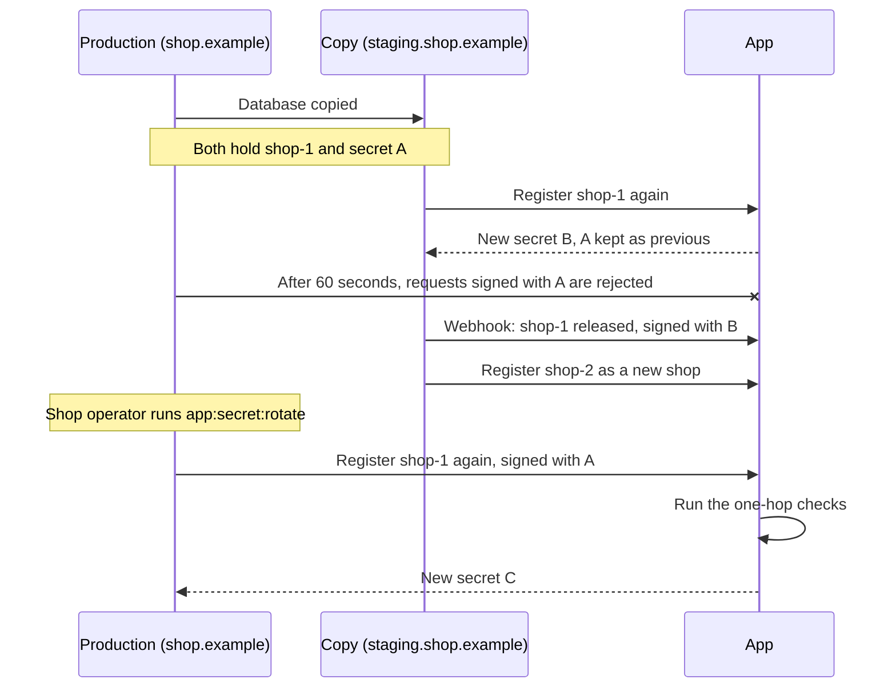

# Limit damage to app relationships after shop cloning

> When a copy of a shop takes over its registration with an app and then leaves, an app that opts in may give the registration back to the original shop automatically, but only if exactly one secret change separates them. Every other case is a manual decision by the app operator.

## Context

A Shopware instance identifies itself to apps by its ShopId and signs requests with a shared secret that each registration renews. The app's server, run by the app operator, keeps one record per ShopId with the current secret, the previous one, and the shop URL that registered each.

A copy of the shop database inherits the ShopId and the secrets. If the copy registers apps again under that ShopId, it takes the shop over: the app switches to a new secret and the original shop is stranded. Its requests are rejected and nothing tells it why.

Running example: production runs at `https://shop.example`, and a shop operator copies its database to `https://staging.shop.example`.

"Move shop permanently" keeps the ShopId. The app SDKs accept the previous secret only for a [60-second grace period](https://github.com/shopware/app-php-sdk/blob/976bd3a993619ac80482d630ca312020033552ad/src/Authentication/DualSignatureRequestVerifier.php#L20) after a change. `reinstall-apps` gives the copy a new ShopId but leaves the app's `shop-1` record on B.

Shop operators control their copies. Staging instructions and Shopware's copy detection, which compares the stored URL and domains with the current ones, help but cannot guarantee that a copy leaves its ShopId before it does damage. Apps need a safe way to undo a takeover after it happened.

Undoing it automatically is risky, because an old secret on its own cannot show which instance should own the ShopId:

- The copy holds the same old secrets as production.
- Running `system:setup:staging` on a new copy, the correct way to set up staging, also leaves the ShopId.
- When production moves to a new server, the old server often keeps running with the older secret.

## Decision

1. Shopware sends a release notice, a new app lifecycle webhook, right before it deletes its stored ShopId. Deleting it is how an instance leaves a ShopId: its next registration creates a new one.
2. An app may opt in to automatic recovery that undoes exactly one takeover, one hop: the original shop holds A, the app's current secret is B, and B directly replaced A.
3. Every other case is a manual decision by the app operator.
4. Shopware's app SDKs implement the notice handling and both kinds of recovery, switched off by default.

### The release notice

The notice is a new app lifecycle webhook, working name `app.shop_id.released`. Apps subscribe to it in their manifest like any other webhook, so the webhook format and how apps verify it stay as they are. Its data names the ShopId being left and the time it was released; the standard `source` part carries the shop URL and an event id. In the example, the app receives:

| Field | Value |
|:---|:---|
| Event | `app.shop_id.released` |
| Shop, in `source` | `shop-1` |
| Shop URL, in `source` | `https://staging.shop.example` |
| Released | when Shopware sent it |
| Signed with | B |

Shopware sends it right before it [deletes the stored ShopId](../src/Core/Framework/App/ShopId/ShopIdProvider.php#L73), the one step every way of leaving passes through. Like the other app lifecycle webhooks, it is [sent right away](../src/Core/Framework/Webhook/Service/WebhookManager.php#L96-L103), not through the queue, and reaches active and inactive apps. The design relies on this: sent right away, the notice is built and signed while the copy is still `shop-1` and holds B. Sent later from the queue, it would be signed with whatever secret the copy holds by then. `reinstall-apps` and `uninstall-apps` already delete the ShopId before they touch the apps. `system:setup:staging` deletes the app records first ([`StagingAppHandler`](../src/Core/Maintenance/Staging/Handler/StagingAppHandler.php#L22-L27)), so it changes to delete the ShopId first.

How the normal webhook path fits:

| Normal webhook behaviour | Effect on the notice |
|:---|:---|
| Webhooks are [dropped](../src/Core/Framework/Webhook/Service/WebhookManager.php#L219) while Shopware has detected a copy and the operator has not yet chosen what to do. | A copy can only take over while its own ShopId check passes, because [registration needs the ShopId](../src/Core/Framework/App/Lifecycle/Registration/HandshakeFactory.php#L46-L53). So the notice is dropped exactly for copies that never took over, which have nothing to release. |
| The ShopId in the body is [read when the webhook is built](../src/Core/Framework/App/Payload/AppPayloadServiceHelper.php#L49). | Built before the deletion, it names `shop-1`, so apps [find the record](https://github.com/shopware/app-php-sdk/blob/976bd3a993619ac80482d630ca312020033552ad/src/Shop/ShopResolver.php#L47-L64). |
| The signing secret is [read when the webhook is sent](../src/Core/Framework/Webhook/Service/WebhookSigningSecretResolver.php#L29). | Sent before the copy registers again, it is signed with B. |
| The event id and the data are fixed when the webhook is built. | Retries carry the same id and release time, so they cannot extend the expiry. |

When a queued webhook is sent, Shopware drops it if the ShopId it names is no longer the instance's own. The release notice is the one exception, so its retries still go out. Without this, ordinary webhooks the copy queued before leaving still reach the app as `shop-1`, signed with B: they would fail check 4, and they would put the copy's data into the record production gets back.

A failed notice never stops the instance from leaving, or the notices to other apps. If deleting the ShopId fails after the notice went out, the copy keeps using B and check 4 refuses recovery.

### Automatic recovery: one verified hop

The app accepts a registration of `shop-1` signed with an older secret only when every check holds. In the example, the copy released `shop-1` with B from `staging.shop.example`, and production proves A from `shop.example`.

| Check | What it stops |
|:---|:---|
| **1. App opted in.** The app enabled automatic recovery. | Apps that do not want this. |
| **2. Copy said it left.** A release notice for `shop-1` is signed with the current secret and comes from the URL that registered that secret. | Staging setup on a new copy: it releases with A, which production's URL registered, so the notice opens nothing. |
| **3. One secret back, right URL.** Both registration requests are signed with the secret the current one directly replaced, and name the URL recorded with it. | Secrets two or more changes old, and honest copies at other URLs, such as a second copy of the same database. |
| **4. B unused since.** The current secret is still the one that signed the notice, and no `shop-1` request other than a notice has used it since the notice arrived. | A copy that kept production's URL and secret A releases while production keeps working with A. Also a shop that already recovered. |
| **5. Notice still fresh.** The notice is younger than the expiry the app sets, counted from when Shopware created it. | An old database dump used months later. Retries and replays carry the same creation time, so they cannot extend it. |

If any check fails, the app refuses. It never falls back to accepting the old secret on its own.

Who gets `shop-1` back:

| Who asks | Result |
|:---|:---|
| Production, holding A at `shop.example` | Handed back |
| An old backup holding the secret before A | Refused at check 3 |
| A second copy holding A at another URL | Refused at check 3 |
| Anyone after a normal staging setup on a new copy | Refused at check 2: no notice was sent |
| Anyone while the copy still uses B | Refused at check 4 |
| Anyone after the notice expired | Refused at check 5 |
| Any shop, app not opted in | Refused at check 1 |
| An old server at production's URL, after a copy that kept that URL left | Handed back wrongly, see the limitations |

A registration is two requests, the first request and the confirmation. The app runs the checks on both, and installs the new secret C in the same step as the last check. Activity with B, or a second recovery, between the two requests therefore makes the confirmation fail.

Recovery then drops A and B at once. It skips the 60-second grace period that a normal change [gives the replaced secret](https://github.com/shopware/app-php-sdk/blob/976bd3a993619ac80482d630ca312020033552ad/src/Registration/RegistrationService.php#L186-L189), so the copy cannot keep acting as `shop-1`. The app records C with production's URL.

Production starts recovery with `app:secret:rotate`, and Shopware needs no change for it: both registration requests are already [signed](../src/Core/Framework/App/Lifecycle/Registration/PrivateHandshake.php#L49-L51) [with](../src/Core/Framework/App/Lifecycle/Registration/AppRegistrationService.php#L253) production's secret A. The SDK checks both against the [current secret only](https://github.com/shopware/app-php-sdk/blob/976bd3a993619ac80482d630ca312020033552ad/src/Authentication/DualSignatureRequestVerifier.php#L150-L192), so it must also accept the previous secret when the checks hold.

### Manual recovery

Outside the rule, the app operator decides. The operator first confirms with the shop operator, through a channel the app already trusts, which instance is the real shop and at which URL it runs. The operator then creates an approval in the app's backend that names:

- the ShopId,
- that confirmed shop URL,
- the old secret the shop must prove, chosen from the secrets the app recorded for that ShopId, however many changes old.

The approval expires after a short time, and the first registration that matches all three uses it up. Production then runs `app:secret:rotate`, and recovery ends as in the automatic case.

## Alternatives

| Option | Why not |
|:---|:---|
| Accept the previous secret on its own | An old server left running after a move takes the shop back from the new one, because nothing shows that the current owner left. |
| Automatic recovery across two or more secret changes | Each extra change accepts an older secret that more copies and backups hold, none of which the app can see. |
| Put the old ShopId in the new ShopId's registration | `uninstall-apps` and `system:setup:staging` never register again, so they could never send it. A new field also breaks every deployed app: Shopware signs the whole registration URL, but the SDK checks the signature against [only three of its fields](https://github.com/shopware/app-php-sdk/blob/976bd3a993619ac80482d630ca312020033552ad/src/Authentication/RequestVerifier.php#L192-L199). |
| Send the notice without automatic recovery | Explains what happened, but production stays stranded. |
| Keep the shop identity outside the copied database | Can itself be copied, and does not repair a takeover that already happened. |
| Store app data by ShopId and URL together | Changes storage and how legitimate moves work, and copies can share a URL. |
| Manual recovery only | Every takeover needs support work. It stays as the fallback. |
| A dedicated notice message outside the webhook path | A change to the app protocol that every app and SDK must learn, for what a normal webhook already does when sent before the deletion. |
| **Release notice as a webhook, one-hop automatic recovery, manual otherwise (chosen)** | |

## Consequences

### Positive

- A single takeover by a copy can be undone without support work once the copy leaves.
- Staging setup on a new copy at its own URL never opens recovery.
- Each app chooses whether to enable it. Without opt-in, nothing changes.
- Recovery needs no Shopware change. Production uses the existing rotate command.
- The notice uses the existing webhook format. Apps subscribe to one more event.
- Webhooks the copy queued before leaving no longer reach the `shop-1` record that production gets back.

### Negative

- **Every ShopId deletion sends a notice.** Shopware sends a notice every time it deletes the ShopId, including every staging setup. Apps that do not opt in ignore it.
- **Work for app vendors.** Recovery only helps apps that update their SDK or implement the checks themselves.

### Limitations

- **The copy must leave.** A copy that keeps running as `shop-1`, or is deleted without leaving, leaves production with manual recovery only.
- **Production is not told.** Nothing tells production it was stranded. Its operator has to notice and run the rotate command.
- **URLs are self-reported.** The URL checks only tell honest instances apart, because each instance reports its own URL. A copy holding A that runs at production's URL, or is modified to name it, can register before production does. It can then send signed requests to the app as `shop-1` and read the answers, but the app's own calls still go to production's URL. Production stays stranded until manual recovery.
- **Copies that share production's URL.** A copy that kept production's URL and secret A sends a valid notice when it leaves. While production is idle, an old server at that URL holding the secret before A can claim the shop.
- **Takeovers are not prevented.** A staging copy can still take over production's registration. This design undoes one takeover afterwards.

### Must ship together

The feature only works if these ship with it, even though apps opt in:

- **SDK support**, off by default: record each secret with its URL and when it last verified a request, and keep older secrets for manual recovery. Handle the notice, run the checks on both registration requests, install C with the last check, and drop both old secrets after recovery. Offer the manual approval.
- **Shopware:** the new webhook event, sent before the ShopId is deleted; dropping queued webhooks that name a ShopId the instance no longer has; and `system:setup:staging` deleting the ShopId before the app records. Without the reorder, a copy that took over and then runs staging setup sends no notice.
- **App developer documentation:** describe the checks, the expiry and the manual approval.

## References

- [APP URL verification](2026-03-18-app-url-verify-utils.md): limits of detecting copies.
- [App secret rotation and recovery](https://beta-developer.shopware.com/docs/guides/plugins/apps/lifecycle/app-secret-recovery.html): recovery after credentials diverge.

> An app gives a ShopId back automatically only after the holder of the current secret said, from the URL that registered it, that it left, and only to a shop that proves the secret directly before it from that secret's URL. Everything else needs an operator approval that names the shop.
