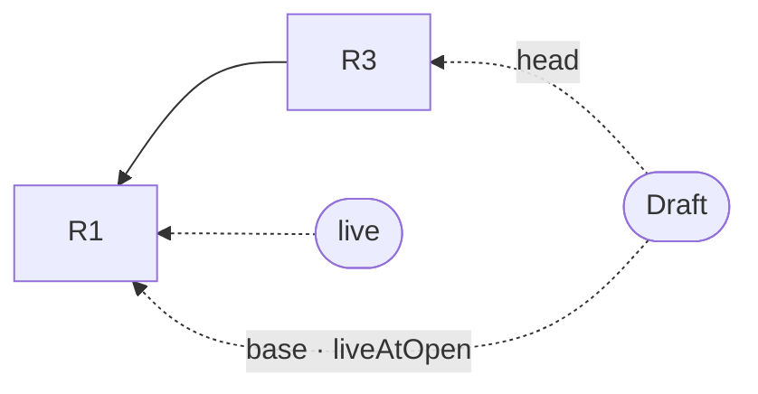
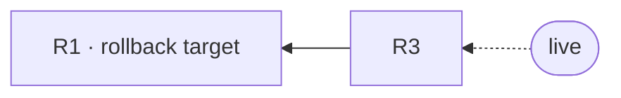

## Context

An Experience Studio layout is stored as one JSON tree in the `layout` column of `content_layout`.
Saving a layout writes that column, so every edit on an assigned layout is visible in the storefront immediately.

Authors need to prepare changes without touching the shop, publish them deliberately and roll back to an earlier state.
Several authors may work on the same layout at the same time, so a layout needs several drafts.

The solution has to respect these constraints:

* Storefront reads must not change.
  They read the `layout` column, and that column has to stay the published state.
* The `layout` column is also written outside any draft flow: live persisted mutations, the Sync API and migrations.
  A draft must never silently revert such a write.
* Every write to the `layout` column runs the full write gate, including resolvability of bindings.
  A draft may contain bindings that do not resolve yet.
* Editing a draft must reuse the existing persisted mutation routes instead of a second editing API.
* Every draft edit produces a full tree, so storage must not grow without bound.

Affected domains: the content layout storage, the persisted mutation pipeline (`PersistedLayoutMutator`), the Admin API of the Experience Studio and the DAL write of `content_layout`.

## Decision

### Revisions form a graph, drafts point into it

Two new tables sit next to `content_layout`; they are no DAL entities and are read and written through `LayoutRevisionStore`.

* `content_layout_revision` holds immutable saved states.
  Each row has the full tree, a `parent_id`, `created_by_id` (the admin user of the edit), `published_at` and `published_by_id` for the first time it went live, and `last_live_at` for the latest.
  The revision the `layout` column holds carries the live pointer `live_content_layout_id`, which is unique, so there is exactly one live revision per layout.
* `content_layout_draft` holds a name, `created_by_id` and three pointers into that graph:
  * `base` (`base_revision_id`): the revision the draft was opened from,
  * `head` (`head_revision_id`): its current state,
  * `liveAtOpen` (`live_at_open_revision_id`): the revision that was live when it was opened.

The rest of this document uses the short names `base`, `head` and `liveAtOpen`.

### Walkthrough: open, edit, publish, roll back

One layout, one author, five steps; the sections after it give the rules behind each step.
Solid arrows are `parent_id`, dashed arrows are pointers: the live pointer of the layout and the three pointers of a draft.
Each step shows the rows of `content_layout_revision` after compaction.

**1. Open a draft.**
The layout has no revision yet, so the first write adopts the `layout` column as `R1`.
The draft copies nothing; all three pointers name the live revision.


**2. Edit the draft twice.**
Every edit appends a revision and moves `head` onto it.
The first edit creates `R2`, the second `R3`; compaction then deletes `R2`, which nothing points at any more, and re-parents `R3` onto `R1`.



**3. Publish the draft.**
The tree of `R3` is written to the `layout` column, the live pointer moves onto `R3`, and the draft is deleted.
`R1` stays without any pointer, as one of the last 20 live revisions: a rollback target.



**4. Open a rollback draft from `R1`.**
`create-draft` with `fromRevisionId` `R1` creates no revision either.
`base` and `head` name `R1`, `liveAtOpen` names `R3`, which was live when the draft was opened.


**5. Publish the rollback.**
The tree of `R1` is written to the `layout` column and the live pointer moves back onto `R1`, whose `last_live_at` is renewed.
No new revision is created; `R3` stays as a rollback target, so the rollback can itself be undone.


| Step | Rows | Live | Draft `base` | Draft `liveAtOpen` | Draft `head` |
|---|---|---|---|---|---|
| 1. Open a draft | `R1` | `R1` | `R1` | `R1` | `R1` |
| 2. Edit twice | `R1`, `R3` | `R1` | `R1` | `R1` | `R3` |
| 3. Publish | `R1`, `R3` | `R3` | – | – | – |
| 4. Open a rollback draft | `R1`, `R3` | `R3` | `R1` | `R3` | `R1` |
| 5. Publish the rollback | `R1`, `R3` | `R1` | – | – | – |

A draft creates at most one revision of its own: its edited `head`.
`base` and `liveAtOpen` point at revisions that already existed and keep them for as long as the draft is open.
They differ only for a rollback and for a draft branched from another draft's `head`, whose `base` is that `head`.
`base` keeps that origin after the draft is edited, so a client can tell a rollback from a draft whose live state moved on.

### The `layout` column stays the source of truth for live

Publishing writes the draft `head` into the `layout` column through the DAL, as any other layout write.
The write gate validates the tree, including resolvability, and `content_layout.written` invalidates caches.

On the same write, the write boundary normalises the tree with the registries at publish time, for example by seeding a type default added since the draft was edited.
The column can then differ from `head`.
In that case the column becomes a new revision on top of `head`, attributed to the publisher, and the live pointer moves onto it.

Writes that bypass publishing are detected, not prevented.
Before every draft write, `LayoutRevisionService::reconcile()` compares the SHA2 checksum of the column with the live revision.
If they differ, the column's content becomes a new live revision whose id is derived from the layout id and the checksum, so the same content is adopted only once.
A layout that has no revision yet is adopted the same way on its first draft write, so existing layouts need no backfill.

### Editing a draft reuses the persisted mutation routes

Each persisted mutation route takes an optional `draftId`.
With it, `PersistedLayoutMutator::mutateDraft()` applies the operation to the draft `head` and `LayoutRevisionService::appendRevision()` stores the result as a new revision.
Draft edits check well-formedness only; resolvability is enforced when publishing.
The optimistic-concurrency token is `expectedHeadRevisionId` instead of `expectedVersion`.

### One lock per layout for writes, none for reads

Every write (create, edit, publish, discard) runs under `LayoutRowLock`, a transaction with `SELECT … FOR UPDATE` on the layout row, which live persisted mutations take as well.
Concurrent writers of one layout therefore serialize, and the stale one fails its `expectedHeadRevisionId` or `expectedVersion` check.

Listing and reading drafts and listing the published revisions take no lock and never reconcile.
`LayoutRevisionStore::draftWithHead()` reads the draft and its `head` tree in one statement, so a concurrent write cannot fall between the two.

### Publishing never replaces a live state the draft has not seen

```
publish(draft, expectedHeadRevisionId):
    if draft.head != expectedHeadRevisionId:                     -> 409 LAYOUT_VERSION_CONFLICT
    if draft.liveAtOpen != live
       and not (isAncestorOrSelf(draft.liveAtOpen, live)  # live only moved forward
                and isAncestorOrSelf(live, draft.head)):  # and the draft contains it
                                                       -> 409 LAYOUT_PUBLISH_CONFLICT
    write draft.head to content_layout.layout through the DAL
    published = draft.head, or a new revision on top of it if the column differs from draft.head
    move live pointer to published, record published_at and published_by_id once, last_live_at every time
    delete draft
    compact()
```

Containment alone is not enough: after a rollback, every newer draft contains the restored revision and would undo the rollback.
A draft branched from another draft's `head` can still be published after that draft, because live only moved forward into it.
This does not hold when publishing that draft made the column a new revision on top of its `head`:
the branched draft does not contain that revision, so it conflicts and has to be reopened from live.

### Compaction after every write

After every edit, publish and discard, `RevisionGraph::compaction()` decides what stays:

* the live revision,
* the 20 most recently live revisions, ranked by `last_live_at`,
* the `base`, `head` and `liveAtOpen` revision of every open draft.

Everything else is deleted.
Each survivor is re-parented onto its nearest surviving ancestor, so ancestry among the survivors is exactly what it was, and the publish rule above judges the same graph.

Compaction runs inside the write's lock, so no scheduled task is needed.
The limit of 20 is the constant `LayoutRevisionService::PUBLISHED_REVISIONS_KEPT`, not a configuration value.

### Admin API

Edits go through the existing persisted mutation routes with a `draftId`.
The draft lifecycle gets new routes in `ContentLayoutDraftController`, under the same `/api/_action/content-system/layout/{layoutId}` prefix; none of them changes a tree, so they stay out of the mutation pipeline.
The writes are named as actions like `remove-element`, the reads name what they return:

| Method | Path | Body | ACL |
|---|---|---|---|
| GET | `/drafts` | | `content_layout:read` |
| GET | `/drafts/{draftId}` | | `content_layout:read` |
| GET | `/published-revisions` | | `content_layout:read` |
| POST | `/create-draft` | `name`, `fromRevisionId` (both optional) | `content_layout:update` |
| POST | `/discard-draft` | `draftId` | `content_layout:update` |
| POST | `/publish-draft` | `draftId`, `expectedHeadRevisionId` | `content_layout:update` |

A draft in a response is `{id, name, baseRevisionId, headRevisionId, liveAtOpenRevisionId, createdAt, createdById, updatedAt}`.
`published-revisions` lists the rollback targets, most recently live first.

### Decided against

* **DAL versioning of `content_layout`.**
  It was the first prototype: a draft was a DAL version of the layout row, and publishing merged it into the live version.
  A merge replays the writes recorded for the version onto the live row without comparing them with its current state.
  The tree is one column, so the merge replaces the whole live tree, including a change made after the draft was opened.
  A scheduled task deletes versions and their recorded writes after `shopware.dal.versioning.expire_days`, 30 by default; an older draft can no longer be merged.
  The DAL has no operation that restores an earlier state of the live row, and a version does not record what it was created from, which the publish rule needs.
* **The whole revision graph in one JSON column of `content_layout`.**
  It was the second prototype: all revisions, all drafts and the published pointer of a layout were one JSON value.
  Every save of any draft decoded and rewrote that value, including the trees of every other author's draft, and listing the drafts decoded all trees.
  With one row per revision, a save inserts one row and listing reads no tree.
* **Drafts that store their tree directly and are overwritten on save.**
  The publish rule needs the draft `head` as a node in the revision graph to decide whether the draft contains the live revision.
* **Keeping every revision of a draft, for undo or a draft history.**
  The graph kept them until compaction was added, but nothing reads them: there is no server-side undo and no route returns a single revision.
  Server-side undo would be one more rule in the kept set of `compaction()`, without a schema change.

## Consequences

* Storefront reads and the `content_layout` entity are unchanged.
* Any write to the `layout` column outside publishing, for example a live mutation or a Sync API write, becomes a new live revision on the next draft write, and drafts opened before it can no longer be published.
* A client can still publish such a draft by opening a new draft from its `head`: that draft's `liveAtOpen` is the current live revision.
  The conflict therefore forces the author to see the new live state, it does not prevent replacing it.
* A rollback reaches the last 20 live states.
  An older `fromRevisionId` is a `404` `CONTENT_LAYOUT_REVISION_NOT_FOUND`.
* A rollback is a publish and runs the current write gate.
  A revision whose element types or references have changed since can be refused or normalised differently.
* A draft can branch from another draft's current `head` only, because earlier heads are deleted.
* Who made an intermediate edit is not kept after the next edit; a revision keeps the author of its own edit and its first publisher.
* Draft edits on different drafts of one layout serialize on the layout lock.
* Draft writes bypass the DAL, so they fire no entity events and invalidate no cache.
  Extensions observe publishing through `content_layout.written`; there is no event for draft edits yet.
* An activity log ("who did what, when") is a separate append-only record of operations, not the revisions, which compaction deletes.
