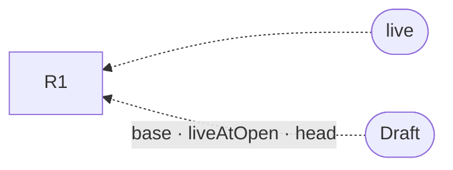
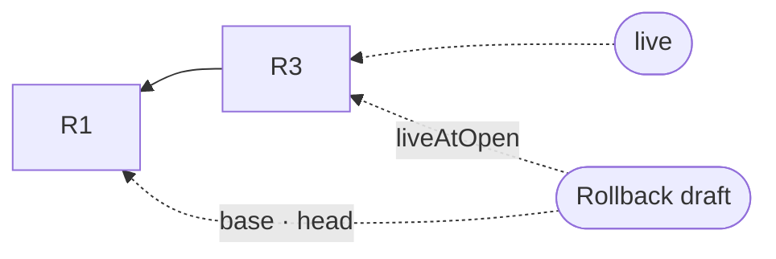
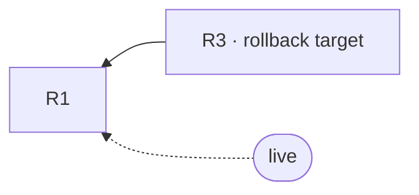

## Context

An Experience Studio layout is stored as one JSON tree in the `layout` column of `content_layout`.
Saving a layout writes that column, so every edit on an assigned layout is visible in the storefront immediately.

Authors need to prepare changes without touching the shop, publish them deliberately and roll back to an earlier state.
Several authors may work on the same layout at the same time, so a layout needs several drafts.

The solution has to respect these constraints:

* Storefront reads must not change.
  They read the `layout` column, and that column has to stay the published state.
* The `layout` column is also written outside any draft flow: live persisted mutations, the Sync API and migrations.
  A draft must never silently revert such a write.
* Every write to the `layout` column runs the full write gate, including resolvability of bindings.
  A draft may contain bindings that do not resolve yet.
* Editing a draft must reuse the existing persisted mutation routes instead of a second editing API.
* Every draft edit produces a full tree, so storage must not grow without bound.

Affected domains: the content layout storage, the persisted mutation pipeline (`PersistedLayoutMutator`), the Admin API of the Experience Studio and the DAL write of `content_layout`.

## Decision

### Revisions form a graph, drafts point into it

Two new tables sit next to `content_layout`; they are no DAL entities and are read and written through `LayoutRevisionStore`.

* `content_layout_revision` holds immutable saved states.
  Each row has the full tree, a `parent_id`, `created_by_id` (the admin user of the edit), `published_at` and `published_by_id` for the first time it went live, and `last_live_at` for the latest.
  The revision the `layout` column holds carries the live pointer `live_content_layout_id`, which is unique, so there is exactly one live revision per layout.
* `content_layout_draft` holds named pointers into that graph: `base` (the revision the draft was opened from), `head` (its latest revision), `live_at_open` (the live revision when it was opened) and `created_by_id`.

A draft copies no tree when it is created.
A rollback is a draft opened from an older published revision via `fromRevisionId`.
The `published-revisions` route lists those revisions, most recently live first, without taking the lock.

### Walkthrough: open, edit, publish, roll back

One layout, one author, five steps.
Solid arrows are `parent_id`, dashed arrows are pointers: the live pointer of the layout and the three pointers of a draft.
Each step shows the rows of `content_layout_revision` after compaction.

**1. Open a draft.**
The layout has no revision yet, so the first write adopts the `layout` column as `R1`.
The draft copies nothing; all three pointers name the live revision.



**2. Edit the draft twice.**
Every edit appends a revision and moves `head` onto it.
The first edit creates `R2`, the second `R3`; compaction then deletes `R2`, which nothing points at any more, and re-parents `R3` onto `R1`.


**3. Publish the draft.**
The tree of `R3` is written to the `layout` column, the live pointer moves onto `R3`, and the draft is deleted.
`R1` stays without any pointer, as one of the last 20 live revisions: a rollback target.


**4. Open a rollback draft from `R1`.**
`create-draft` with `fromRevisionId` `R1` creates no revision either.
`base` and `head` name `R1`, `liveAtOpen` names `R3`, which was live when the draft was opened; this is the one case besides branching where `base` and `liveAtOpen` differ.



**5. Publish the rollback.**
The tree of `R1` is written to the `layout` column and the live pointer moves back onto `R1`, whose `last_live_at` is renewed.
No new revision is created; `R3` stays as a rollback target, so the rollback can itself be undone.



| Step | Rows | Live | Draft `base` | Draft `liveAtOpen` | Draft `head` |
|---|---|---|---|---|---|
| 1. Open a draft | `R1` | `R1` | `R1` | `R1` | `R1` |
| 2. Edit twice | `R1`, `R3` | `R1` | `R1` | `R1` | `R3` |
| 3. Publish | `R1`, `R3` | `R3` | – | – | – |
| 4. Open a rollback draft | `R1`, `R3` | `R3` | `R1` | `R3` | `R1` |
| 5. Publish the rollback | `R1`, `R3` | `R1` | – | – | – |

A draft therefore owns at most one revision of its own, its edited head.
`base` and `liveAtOpen` only point at revisions that were live, and keep them beyond the last 20 for as long as the draft is open.

### The `layout` column stays the source of truth for live

Publishing writes the draft head into the `layout` column through the DAL, so the full write gate runs and `content_layout.written` invalidates caches as for any other layout write.
Then it moves the live pointer and deletes the draft.
The write boundary runs again on that write and depends on the registries at publish time, so the column can differ from the head, for example by a type default added since the draft was edited.
In that case the column becomes a new revision on top of the head, attributed to the publisher, and the live pointer moves onto it.
Otherwise the next write would adopt the column as an unattributed revision, and every other open draft would conflict with it.

Writes that bypass publishing are detected, not prevented.
Before every write, `LayoutRevisionService::reconcile()` compares the SHA2 checksum of the column with the live revision.
If they differ, the column's content becomes a new live revision whose id is derived from the layout id and the checksum, so the same content is adopted only once.
A layout that has no revision yet is adopted the same way on its first write, so existing layouts need no backfill.

### Editing a draft reuses the persisted mutation routes

Each persisted mutation route takes an optional `draftId`.
With it, `PersistedLayoutMutator::mutateDraft()` applies the operation to the draft head and `LayoutRevisionService::appendRevision()` stores the result as a new revision.
Draft edits check well-formedness only; resolvability is enforced when publishing.
The optimistic-concurrency token is `expectedHeadRevisionId` instead of `expectedVersion`.

### One lock per layout for writes, none for reads

Every write (create, edit, publish, discard) runs under `LayoutRowLock`, a transaction with `SELECT … FOR UPDATE` on the layout row, which live persisted mutations take as well.
Concurrent writers of one layout therefore serialize, and the stale one fails its `expectedHeadRevisionId` or `expectedVersion` check.

Listing and reading drafts and listing the published revisions take no lock and never reconcile.
`LayoutRevisionStore::draftWithHead()` reads the draft and its head tree in one statement, so a concurrent write cannot fall between the two.

### Publishing never replaces a live state the draft has not seen

```
publish(draft, expectedHeadRevisionId):
    if draft.head != expectedHeadRevisionId:                     -> 409 LAYOUT_VERSION_CONFLICT
    if draft.liveAtOpen != live
       and not (isAncestorOrSelf(draft.liveAtOpen, live)  # live only moved forward
                and isAncestorOrSelf(live, draft.head)):  # and the draft contains it
                                                       -> 409 LAYOUT_PUBLISH_CONFLICT
    write draft head to content_layout.layout through the DAL
    published = draft.head, or a new revision on top of it if the column differs from the head
    move live pointer to published, record published_at and published_by_id once, last_live_at every time
    delete draft
    compact()
```

Containment alone is not enough: after a rollback, every newer draft contains the restored revision and would undo the rollback.
A draft branched from another draft's head can still be published after that draft, because live only moved forward into it.
This does not hold when publishing that draft made the column a new revision on top of its head:
the branched draft does not contain that revision, so it conflicts and has to be reopened from live.

### Compaction after every write

After every edit, publish and discard, `RevisionGraph::compaction()` decides what stays:

* the live revision,
* the 20 most recently live revisions,
* the `base`, `head` and `live_at_open` revision of every open draft.

Everything else is deleted.
Each survivor is re-parented onto its nearest surviving ancestor, so ancestry among the survivors is exactly what it was, and the publish rule above judges the same graph.
Ranking by `last_live_at` instead of `published_at` keeps a revision restored by a rollback, so the publish after the rollback can be undone as well.

As a result, a draft holds only its head, a published draft leaves only the published state, and an untouched draft costs at most three revisions.
Compaction runs inside the write's lock, so no scheduled task is needed.
The limit of 20 is the constant `LayoutRevisionService::PUBLISHED_REVISIONS_KEPT`, not a configuration value.

### Admin API

Edits need no route of their own: they go through the existing persisted mutation routes with a `draftId`.
Only the draft lifecycle gets new routes, under the same `/api/_action/content-system/layout/{layoutId}` prefix as those mutation routes.
They sit in `ContentLayoutDraftController` rather than `ContentLayoutMutationController`, because none of them changes a tree:
creating a draft has no `draftId` yet, the reads mutate nothing, and publishing and discarding move pointers.
Every route of the mutation controller runs one tree operation through the same pipeline, and these would break that.
The writes are named as actions like `remove-element`, the reads name what they return:

| Method | Path | Body | ACL |
|---|---|---|---|
| GET | `/drafts` | | `content_layout:read` |
| GET | `/drafts/{draftId}` | | `content_layout:read` |
| GET | `/published-revisions` | | `content_layout:read` |
| POST | `/create-draft` | `name`, `fromRevisionId` (both optional) | `content_layout:update` |
| POST | `/discard-draft` | `draftId` | `content_layout:update` |
| POST | `/publish-draft` | `draftId`, `expectedHeadRevisionId` | `content_layout:update` |

A draft in a response is `{id, name, baseRevisionId, headRevisionId, liveAtOpenRevisionId, createdAt, createdById, updatedAt}`.
`baseRevisionId` says where the draft came from, `liveAtOpenRevisionId` which live state its author saw; a client needs both to tell a rollback from a draft whose live state moved on.

### Decided against

* **Dropping `base`, since it equals `live_at_open` for a normal draft.**
  The publish rule reads only `live_at_open` and `head`, but for a rollback or a branched draft `base` is the only record of the revision it started from; once the draft is edited and compaction runs, that origin cannot be reconstructed.
  A diff of what a draft changed and a later merge both need it.
* **A separate publication table.**
  The live pointer on the revision row, made unique by `live_content_layout_id`, already says which revision is live.
* **A route that saves a whole tree into a draft.**
  It duplicated the persisted mutation routes; a client such as a copilot edits a draft through the same routes as the Administration.
* **Drafts that store their tree directly and are overwritten on save.**
  The publish rule needs the draft head as a node in the revision graph to decide whether the draft contains the live revision.
* **Keeping intermediate draft revisions, for example the last 50 per draft.**
  Nothing reads them today: there is no server-side undo and no route returns a single revision.
  If server-side undo is built, it becomes one more rule in the kept set of `compaction()`, without a schema change.
* **Retention by age through a scheduled task.**
  With a full tree per edit, storage within any age window is unbounded, and a count is easier to explain to authors.
* **Using revisions as an activity log.**
  A revision stores the resulting tree, not the operation, the affected elements or the draft it belonged to.

## Consequences

* Storefront reads and the `content_layout` entity are unchanged.
* A write to the `layout` column outside publishing, for example through the Sync API, becomes a new live revision on the next draft write, and drafts opened before it can no longer be published.
* A rollback reaches the last 20 live states.
  An older `fromRevisionId` is a `404` `CONTENT_LAYOUT_REVISION_NOT_FOUND`.
* A draft can branch from another draft's current head only, because earlier heads are deleted.
* Who made an intermediate edit is not kept after the next edit; a revision keeps the author of its own edit and its first publisher.
* Draft edits on different drafts of one layout serialize on the layout lock.
* Draft writes bypass the DAL, so they fire no entity events and invalidate no cache.

## Extensibility

The classes of this feature are `@internal`, and no event is dispatched for draft edits.
Publishing and live edits write the `layout` column through the DAL, so extensions observe them through `content_layout.written`.

An activity log ("who did what, when") is a separate append-only record of operations, written at the points where `PersistedLayoutMutator` and `LayoutRevisionService` already know the operation, the affected elements, the draft and the user.
It references revisions without a foreign key, because compaction deletes them.
A public event for draft edits is designed together with that log, so its payload carries no `@internal` types.
