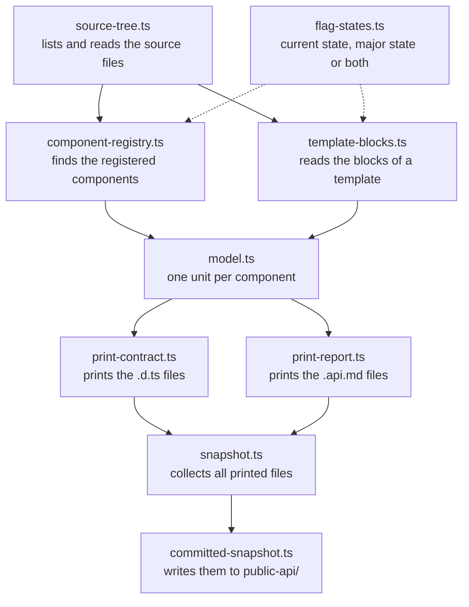

# Public API snapshot generator

This folder generates the snapshot of the Administration public API in `public-api/`.
It also holds the fixtures and the first parts of the break check that will compare two snapshots.

The format of the generated files and the markers are described in `technical-docs/11-code-quality/03-public-api-snapshot.md`.
This file explains how the code is organised.

## How a run works



A run goes through four stages, and each stage only knows the one before it.

1. Source tree:
   `source-tree.ts` lists the source files below `src/` and reads them on demand.
   Specs, mocks and fixtures are left out.
2. Model:
   `model.ts` builds one `ComponentUnit` per registered component.
   It gets the registrations from `component-registry.ts` and the blocks of each template from `template-blocks.ts`.
3. Printers:
   `print-contract.ts` turns a unit into its `.d.ts` files, `print-report.ts` into its `.api.md` file.
   `snapshot.ts` prints `index.json` and collects everything.
4. Disk:
   `committed-snapshot.ts` is the only file that writes to `public-api/`.

`generateSnapshot` in `snapshot.ts` covers stages 1 to 3 and returns the files in memory.
The tests therefore run without touching the disk.

## Files

| File | Job |
|---|---|
| `index.ts` | The command line entry of `composer admin:generate-public-api` |
| `committed-snapshot.ts` | Generates the snapshot of this checkout, reads the major flags from `feature.yaml`, reads and writes `public-api/` |
| `snapshot.ts` | `generateSnapshot`: source tree, model and printers in one call |
| `source-tree.ts` | Which files count as source, and access to their content |
| `component-registry.ts` | Finds `Component.register`, `extend` and `override` calls, the files behind them and their `@private` tags |
| `template-blocks.ts` | Reads the blocks of a Twig template or a `.vue` file, with their parent and flag states |
| `flag-states.ts` | Decides in which flag state a piece of source exists |
| `model.ts` | The data the printers work on, and the checks that stop a run |
| `print-contract.ts` | Prints `<name>.d.ts` and `<name>.major.d.ts` |
| `print-report.ts` | Prints `<name>.api.md` |
| `print-shared.ts` | Texts that both printers use |
| `code-point-order.ts` | The sort order of everything that is printed |
| `break-check.ts`, `findings.ts` | The break check and the summary it prints. The check itself is not built yet |
| `fixture-runner.ts`, `expected-failures.ts`, `__fixtures__/` | The fixture cases and how they are compared |

## Flag states

The snapshot describes two states: `current`, with the major flags off, and `major`, with them on.
The generator never runs twice for that.
Every element in the model carries a `FlagStates` value that says in which of the two it exists, and the printers split or merge the states.

`flag-states.ts` evaluates `feature.isActive('<flag>')` in two places: in `v-if` chains of a template and in `if` statements around a registration.
`existingElements` in `model.ts` combines the state of a component with the state of its elements.
Use it for every new kind of element.

## How templates are read

A block's flag state depends on the HTML elements around it, so Twig and HTML have to end up in one tree.
`template-blocks.ts` replaces every `` and `` with an HTML comment and parses the result with `@vue/compiler-dom`.
The comments keep the position of the tags, and `<sw-block>` elements are ordinary nodes of the same tree.

## Rules the code follows

- The generator throws when it cannot read something, for example a block that belongs to no registered component.
  A silent gap in the snapshot would look like a removed API.
- The same sources always give the same bytes.
  Everything is sorted with `byCodePoint`, and the files contain no absolute paths, line numbers or dates.
- The major flags are an argument of `generateSnapshot`.
  The feature flags that are active in the process have no effect on the result.

## Tests

| Spec | What it checks |
|---|---|
| `fixtures.spec.ts` | Every case in `__fixtures__/` against its hand-written expected output |
| `snapshot.spec.ts` | Single behaviours of the generator on small source trees given as strings |
| `committed-snapshot.spec.ts` | The real Administration: the committed snapshot is up to date, and two runs give the same bytes |
| `fixture-runner.spec.ts`, `findings.spec.ts` | The fixture comparison and the summary of the break check |

Run them in the Administration folder:

```bash
npx jest --collectCoverage=false scripts/generate-public-api
```

## Adding a new part

1. Add its fixture cases, and list what cannot pass yet in `expected-failures.ts`.
2. Add the data to `ComponentUnit` in `model.ts`, or a new unit type next to it.
3. Print it in `print-contract.ts`, `print-report.ts` and the index.
4. Remove the entries from `expected-failures.ts` once the comparisons pass.
5. Run `composer admin:generate-public-api` and commit the changed files in `public-api/`.

The steps for fixtures and unit kinds are described in detail in the technical documentation named at the top.
