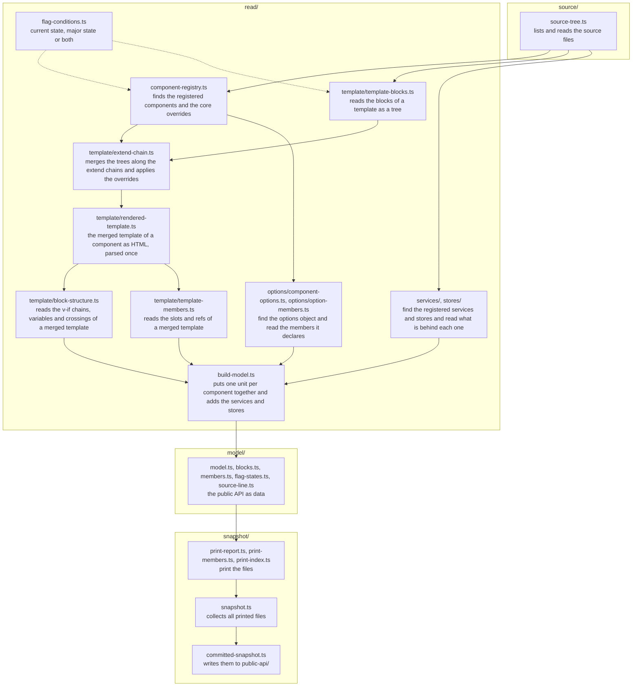
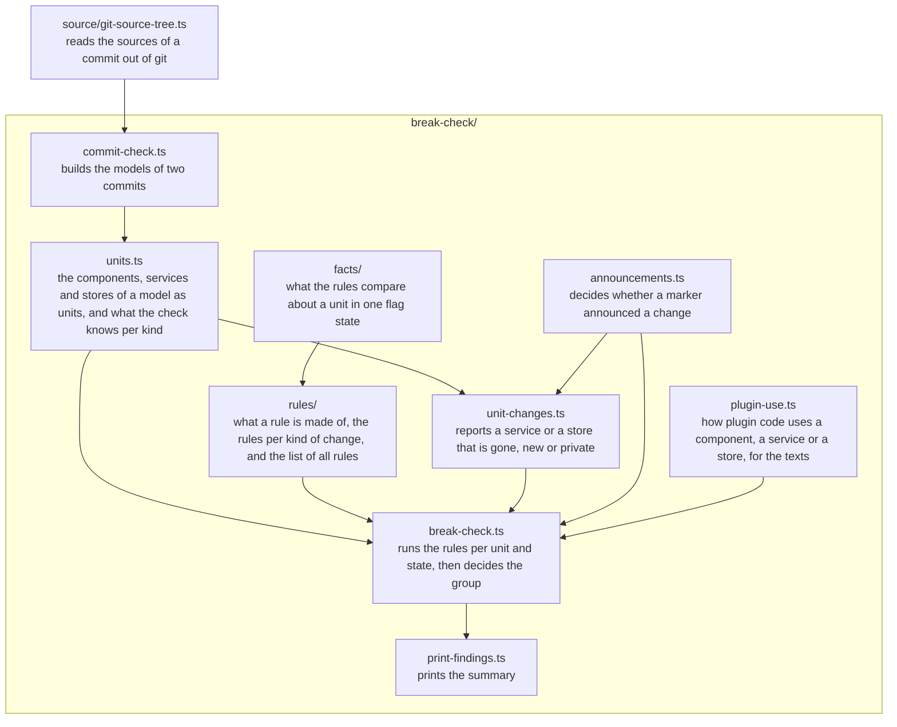

# Public API snapshot generator

This folder generates the snapshot of the Administration public API in `public-api/`.
It also holds the break check, which compares the snapshots of two commits, and the fixtures for both.

The format of the generated files, the markers, and the steps to add a new part are described in `technical-docs/11-code-quality/03-public-api-snapshot.md`.
This file explains how the code is organised.
Each file says in its header, or above the one thing it exports, what it does.

## Folders

A run goes through the folders in this order.
A source file only imports from its own folder and from the folders above it in the table.
A spec also imports from `testing/` and from the step it observes the result through, mostly `snapshot/`.

| Folder | What it holds |
|---|---|
| `helpers/` | Small pure functions that every step may use, such as the code point order. It imports from no other folder |
| `source/` | Lists and reads the source files, from a checkout or from a commit in git, and knows where this checkout is |
| `model/` | The public API as data: the types every later step works on, without a parser and without file access |
| `read/` | Turns the sources into the model, with `template/` for Twig and Vue templates, `options/` for the options object of a component, `services/` for the registered services and `stores/` for the registered stores |
| `snapshot/` | Prints the model into the files of `public-api/` |
| `break-check/` | Compares two models, with `facts/` for what the rules compare about a unit and `rules/` for the rules |
| `testing/` | The fixture cases, their runner, and the example components, services and stores the specs share |

`generate.ts` and `check.ts` are the two commands.
`snapshot/` and `break-check/` take one thing from `read/`: `buildModel` with its options, which they call to get a model.

## How a run works



`generateSnapshot` in `snapshot/snapshot.ts` returns the files in memory, so the tests run without touching the disk.
`snapshot/committed-snapshot.ts` is the only file that writes to `public-api/`.

Every element in the model carries a `FlagStates` value that says in which of the two flag states it exists.
`read/build-model.ts` limits the elements of a component to the states in which the component is registered, so the printers only split or merge states.
A new kind of element goes through `existingIn` in `componentUnit`.

`read/template/template-blocks.ts` replaces every ``, `` and `` with an HTML comment and parses the result with `@vue/compiler-dom`.
That way Twig blocks and `<sw-block>` elements end up in one tree, and the `v-if` chains around a block decide its flag state.
`read/template/template-nodes.ts` holds the parser call and the node helpers that the template readers share.
`read/template/flag-branches.ts` follows the `v-if` chains of a parsed template for `template-members.ts`.
The tree keeps the order of the source, because the merge in `extend-chain.ts` depends on it.
The tree also keeps the HTML between the Twig tags as markup, which the merge carries along without reading it.
`listBlocks` in `read/template/block-tree.ts` turns a merged tree into the entries of `model/blocks.ts`, which the printers use.

`read/template/extend-chain.ts` follows the rules of `src/core/factory/template.factory.js` and names the function of the runtime above each of its own.
A block keeps two flag state values: `within`, the conditions between it and the block around it, and `states`, where it renders.
When a redeclaration moves content to another place, `states` is computed again from `within`, because the conditions around the old place no longer apply.

`read/template/rendered-template.ts` puts the merged tree of a component together as one template again and parses it once more.
What an override can rely on depends on the template Vue compiles, and a block of an extend child sits between markup of its parent.
`block-structure.ts` and `template-members.ts` both read that template, so neither needs rules of its own for `` or for a block that moved.

`model/members.ts` describes a member of a component: a prop, a method, a slot, a ref and so on.
Every kind is a list of named members with a few details of its own, so the printer and the rules of the break check handle all kinds the same way.
A new kind needs its details and its entry in `MEMBER_KINDS`, a reader, a line format in `snapshot/print-members.ts` and an entry in `COMING_AND_GOING` in `break-check/rules/member-rules.ts`.
The compiler reports each of these while it is missing, and also a kind with a type that `TYPED` in `member-rules.ts` does not list.
A kind that plugin code calls has to join `CALLABLE_KINDS` in `model/members.ts` by hand, which gives it the rules for parameters and results.
`read/options/option-members.ts` reads the kinds of the options object from the syntax tree, with one reader per option in `SECTIONS`, and never runs the source.
`read/options/option-helpers.ts` lists the helpers that components spread into `computed` and `methods`, with the names each call adds.
What the reader cannot resolve becomes a note in the report, because a member that silently goes missing would look like a removed API.
`read/script-nodes.ts` holds the node helpers for scripts, as `template-nodes.ts` does for templates.

`read/declarations.ts` finds what a name in a script stands for: a `const`, a function or a class of an enclosing scope or of the file, or what an import brings in.
`read/services/service-registry.ts` finds the registrations with it, and `provided-object.ts` follows a provider to the class or object literal behind the service.
`object-members.ts` reads the members of that class or literal, and `service-units.ts` puts the units together, with the classes that services are instances of.
`read/member-reading.ts` holds what the readers of members share: the name, line and comment of a member, and the signature of a function.
A service has the member kinds `property` and `method`, so the printers and the rules for a method are those of a component.
`read/stores/store-registry.ts` finds the `Store.register` calls, `store-members.ts` reads the state, getters and actions of an options store and of a setup store, and `store-units.ts` puts the units together.
An action is a callable kind like a method, see `CALLABLE_KINDS` in `model/members.ts`, so the rules for a method run on it.
`read/registered-units.ts` builds what a service and a store share: the files, the visibility and the markers of a unit that a script declares.
`read/global-interfaces.ts` reads `ServiceContainer` and `PiniaRootState`.

`snapshot/report-outline.ts` holds the lines and sections a report is made of, and the file around them.
`print-report.ts` fills it for a component, `print-registered-reports.ts` for the services and for the stores of a source file, and `print-members.ts` prints the member sections of all of them.

## How the break check works



`classifyChanges` in `break-check/break-check.ts` takes the models of two commits and returns findings, without touching git or the disk.
A rule knows nothing about flag states, markers or visibility.
It gets the facts of one unit in one state at the base and at the head, and returns the changes with the element each one is about.
`units.ts` turns the components, the services and the stores of a model into units, so the rules run on all of them.
It also makes a unit of each class that services are instances of, which only reports a change that several of its services share.
A service or a store has no template, so its facts hold no blocks and the block rules find nothing.
`break-check.ts` joins what a rule found in both states, and then decides whether the unit is private and whether an extend child or a service only inherits the finding.
`announcements.ts` decides whether a marker announced the change.
The text of a finding gets the wording for its kind of unit from `plugin-use.ts`: a plugin reaches a method of a component through `$super`, one of a service through `Shopware.Service('<name>')`, and an action of a store through `Shopware.Store.get('<id>')`.
`unit-changes.ts` compares the units themselves and reports a service or a store that only one commit has, or that became private.
`rules/texts.ts` holds the texts that such a finding shares with the one about a member, and `findingFor` in `finding.ts` puts both kinds of finding together.
A new rule for blocks is one entry in `BLOCK_RULES`, and one for members an entry in `MEMBER_RULES`.
A new kind of unit is one entry in `UNIT_KINDS` in `units.ts`, with how the model lists its units and how plugin code uses one.
`rules/member-rules.ts` builds the rules for a member that is gone or new from `COMING_AND_GOING`, which has one entry per kind, so a new kind gets them without a rule of its own.
The rules for another part of a component get a file of their own in `rules/` and join `RULES` in `rules/index.ts`.
Its facts get a file of their own in `facts/` and join `UnitFacts` in `facts/unit-facts.ts`.

## Rules the code follows

- The generator throws when it cannot read something, for example a block that belongs to no registered component.
  A silent gap in the snapshot would look like a removed API.
- The same sources always give the same bytes.
  Everything is sorted with `byCodePoint`, and the files contain no absolute paths, line numbers or dates.
- The major flags are an argument of `generateSnapshot`.
  The feature flags that are active in the process have no effect on the result.

## Tests

| Spec | What it checks |
|---|---|
| `testing/fixtures.spec.ts` | Every case in `testing/__fixtures__/` against its hand-written expected output |
| `snapshot/snapshot.spec.ts` | Single behaviours of the generator on small source trees given as strings |
| `read/template/extend-chain.spec/snapshot.spec.ts` | How the snapshot shows extend children and core overrides, and the chains the generator rejects |
| `read/template/extend-chain.spec/runtime.spec.ts` | The merged blocks against the runtime: one case per merge rule, and every component of the real Administration |
| `read/template/block-structure.spec/snapshot.spec.ts` | How the snapshot shows the context of a block and the crossings, also for extend children |
| `read/template/block-structure.spec/compiler.spec.ts` | The context and the crossings against the Vue compiler, for every block of the real Administration |
| `read/options/option-members.spec/snapshot.spec.ts` | How the snapshot shows each kind of member, in every form the sources write one |
| `read/options/option-members.spec/runtime.spec.ts` | The member names against the options objects at runtime, for every component of the real Administration |
| `read/services/service-units.spec.ts` | How the snapshot shows a service, for every way the sources register and declare one, and the registrations the generator rejects |
| `read/stores/store-units.spec.ts` | How the snapshot shows an options store and a setup store, and the registrations the generator rejects |
| `break-check/break-check.spec/block-rules.spec.ts` | What each rule of the break check reports for a change to the blocks |
| `break-check/break-check.spec/member-rules.spec.ts` | What each rule of the break check reports for a change to the members |
| `break-check/break-check.spec/method-rules.spec.ts` | What each rule of the break check reports for a change to the parameters, the result and the return type of a method |
| `break-check/break-check.spec/service-rules.spec.ts` | What the break check reports for a service that is gone, new or private, and for a change to its members |
| `break-check/break-check.spec/store-rules.spec.ts` | What the break check reports for a store that is gone, new or private, and for a change to its state, getters and actions |
| `break-check/break-check.spec/verdict.spec.ts` | What the break check reports as announced, private or inherited by an extend child |
| `break-check/commit-check.spec.ts` | The break check on the commits of a repository that the spec creates |
| `snapshot/committed-snapshot.spec.ts` | The real Administration: the committed snapshot is up to date and holds nothing machine-specific |
| `testing/fixture-runner.spec/`, `break-check/print-findings.spec.ts` | The fixture comparison and the summary of the break check |

`testing/example-components.ts`, `testing/example-services.ts` and `testing/example-stores.ts` build the small source trees that the specs share.

Run them in the Administration folder:

```bash
npx jest --collectCoverage=false scripts/generate-public-api
```
