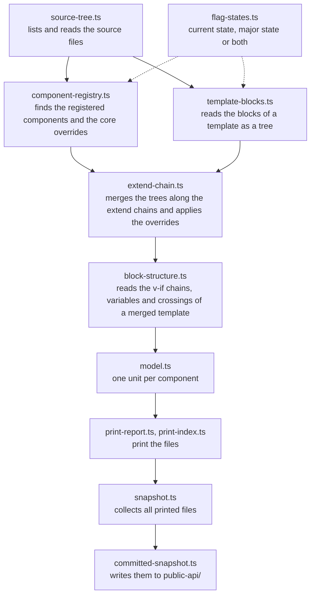
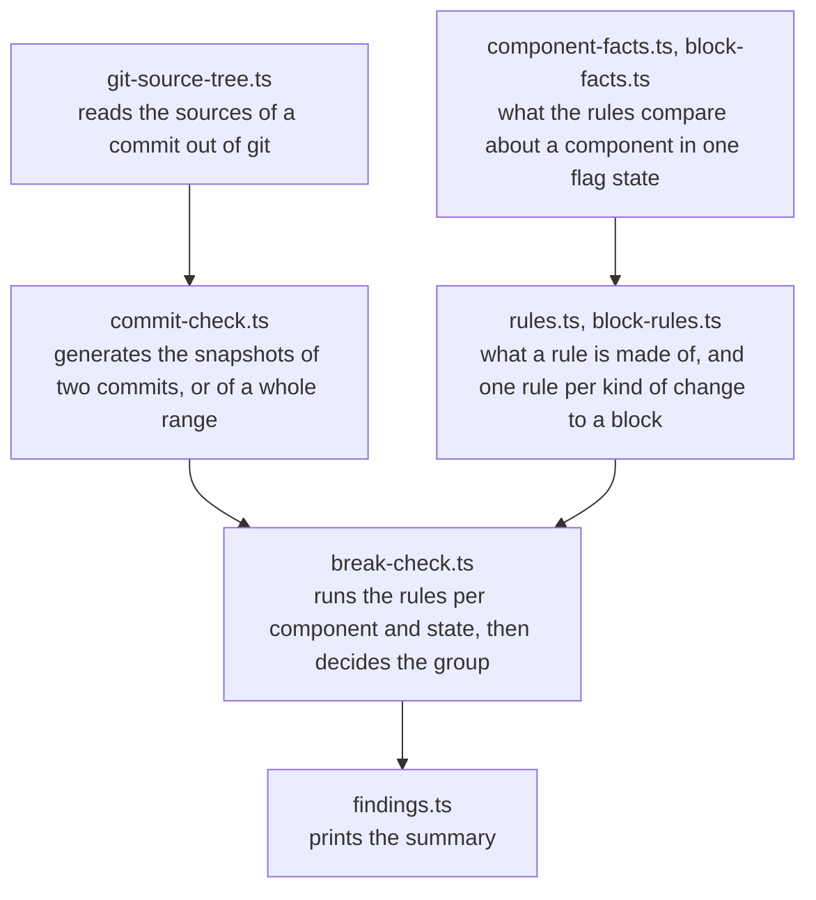

# Public API snapshot generator

This folder generates the snapshot of the Administration public API in `public-api/`.
It also holds the break check, which compares the snapshots of two commits, and the fixtures for both.

The format of the generated files, the markers, and the steps to add a new part are described in `technical-docs/11-code-quality/03-public-api-snapshot.md`.
This file explains how the code is organised.
Each file says in its header what it does.

## How a run works



`generateSnapshot` in `snapshot.ts` returns the files in memory, so the tests run without touching the disk.
`committed-snapshot.ts` is the only file that writes to `public-api/`.

Every element in the model carries a `FlagStates` value that says in which of the two flag states it exists.
`model.ts` limits the elements of a component to the states in which the component is registered, so the printers only split or merge states.
A new kind of element goes through `existingIn` in `componentUnit`.

`template-blocks.ts` replaces every ``, `` and `` with an HTML comment and parses the result with `@vue/compiler-dom`.
That way Twig blocks and `<sw-block>` elements end up in one tree, and the `v-if` chains around a block decide its flag state.
`template-nodes.ts` holds the parser call and the node helpers that this reader and `block-structure.ts` share.
The tree keeps the order of the source, because the merge in `extend-chain.ts` depends on it.
The tree also keeps the HTML between the Twig tags as markup, which the merge carries along without reading it.
`listBlocks` in `block-tree.ts` turns a merged tree into the entries the printers use.

`extend-chain.ts` follows the rules of `src/core/factory/template.factory.js` and names the function of the runtime above each of its own.
A block keeps two flag state values: `within`, the conditions between it and the block around it, and `states`, where it renders.
When a redeclaration moves content to another place, `states` is computed again from `within`, because the conditions around the old place no longer apply.

`block-structure.ts` puts the merged tree of a component together as one template again and parses it once more.
What an override can rely on depends on the template Vue compiles, and a block of an extend child sits between markup of its parent.
Reading the structure after the merge needs no rules of its own for `` or for a block that moved.

## How the break check works



`classifyChanges` in `break-check.ts` takes the models of two commits and returns findings, without touching git or the disk.
A rule knows nothing about flag states, markers or visibility.
It gets the facts of one component in one state at the base and at the head, and returns the changes with the element each one is about.
`break-check.ts` joins what a rule found in both states, and then decides whether a marker announced the change, whether the component is private, and whether an extend child only inherits the finding.
A new rule for blocks is one entry in `BLOCK_RULES`.
The rules of another unit kind get a file of their own and join `RULES` in `break-check.ts`.
Its facts get a file of their own too and join `ComponentFacts` in `component-facts.ts`.

## Rules the code follows

- The generator throws when it cannot read something, for example a block that belongs to no registered component.
  A silent gap in the snapshot would look like a removed API.
- The same sources always give the same bytes.
  Everything is sorted with `byCodePoint`, and the files contain no absolute paths, line numbers or dates.
- The major flags are an argument of `generateSnapshot`.
  The feature flags that are active in the process have no effect on the result.

## Tests

| Spec | What it checks |
|---|---|
| `fixtures.spec.ts` | Every case in `__fixtures__/` against its hand-written expected output |
| `snapshot.spec.ts` | Single behaviours of the generator on small source trees given as strings |
| `extend-chain.spec/snapshot.spec.ts` | How the snapshot shows extend children and core overrides, and the chains the generator rejects |
| `extend-chain.spec/runtime.spec.ts` | The merged blocks against the runtime: one case per merge rule, and every component of the real Administration |
| `block-structure.spec/snapshot.spec.ts` | How the snapshot shows the context of a block and the crossings, also for extend children |
| `block-structure.spec/compiler.spec.ts` | The context and the crossings against the Vue compiler, for every block of the real Administration |
| `break-check.spec/rules.spec.ts` | What each rule of the break check reports for a change |
| `break-check.spec/verdict.spec.ts` | What the break check reports as announced, private or inherited by an extend child |
| `commit-check.spec.ts` | The break check on the commits of a repository that the spec creates |
| `committed-snapshot.spec.ts` | The real Administration: the committed snapshot is up to date and holds nothing machine-specific |
| `fixture-runner.spec.ts`, `findings.spec.ts` | The fixture comparison and the summary of the break check |

`example-components.ts` builds the small source tree that the specs of the block structure and of the break check share.

Run them in the Administration folder:

```bash
npx jest --collectCoverage=false scripts/generate-public-api
```
