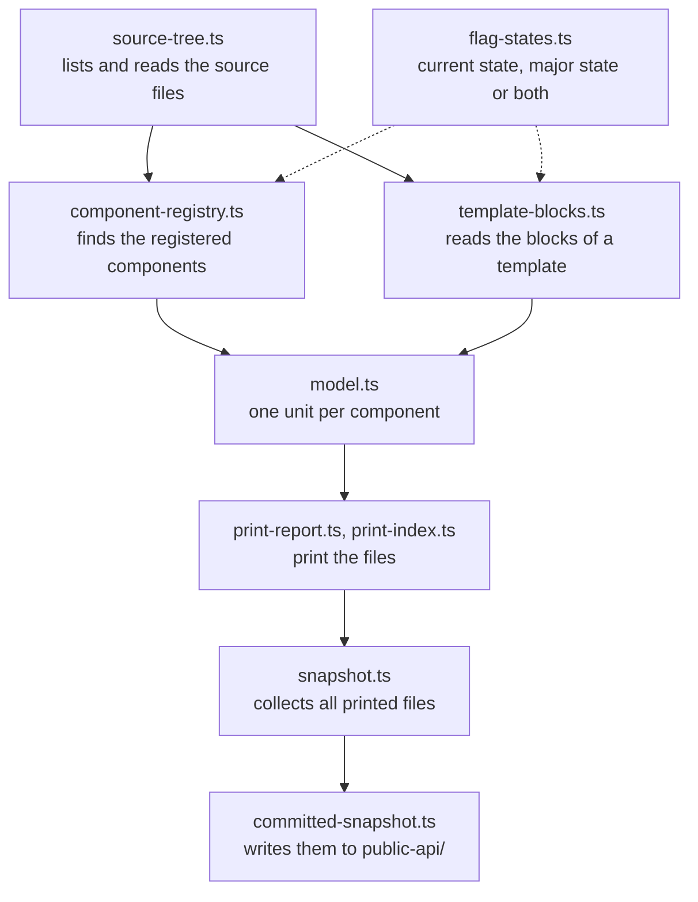

# Public API snapshot generator

This folder generates the snapshot of the Administration public API in `public-api/`.
It also holds the fixtures and the first parts of the break check that will compare two snapshots.

The format of the generated files, the markers, and the steps to add a new part are described in `technical-docs/11-code-quality/03-public-api-snapshot.md`.
This file explains how the code is organised.
Each file says in its header what it does.

## How a run works



`generateSnapshot` in `snapshot.ts` returns the files in memory, so the tests run without touching the disk.
`committed-snapshot.ts` is the only file that writes to `public-api/`.

Every element in the model carries a `FlagStates` value that says in which of the two flag states it exists.
`model.ts` limits the elements of a component to the states in which the component is registered, so the printers only split or merge states.
A new kind of element goes through `existingIn` in `componentUnit`.

`template-blocks.ts` replaces every `` and `` with an HTML comment and parses the result with `@vue/compiler-dom`.
That way Twig blocks and `<sw-block>` elements end up in one tree, and the `v-if` chains around a block decide its flag state.

## Rules the code follows

- The generator throws when it cannot read something, for example a block that belongs to no registered component.
  A silent gap in the snapshot would look like a removed API.
- The same sources always give the same bytes.
  Everything is sorted with `byCodePoint`, and the files contain no absolute paths, line numbers or dates.
- The major flags are an argument of `generateSnapshot`.
  The feature flags that are active in the process have no effect on the result.

## Tests

| Spec | What it checks |
|---|---|
| `fixtures.spec.ts` | Every case in `__fixtures__/` against its hand-written expected output |
| `snapshot.spec.ts` | Single behaviours of the generator on small source trees given as strings |
| `committed-snapshot.spec.ts` | The real Administration: the committed snapshot is up to date and holds nothing machine-specific |
| `fixture-runner.spec.ts`, `findings.spec.ts` | The fixture comparison and the summary of the break check |

Run them in the Administration folder:

```bash
npx jest --collectCoverage=false scripts/generate-public-api
```
