# Rendering Data Flow

```mermaid
graph LR
    REQ(["GET /store-api/content/{path}"]) --> A

    A["Layout Loading<br/>fetch assigned layout"]

    subgraph FULLONLY["FULL mode only"]
        direction TB
        B["Placeholder Replacement<br/>{{productId}} → UUID"]
        C["Data Loading<br/>element and consumed page requirements"]
        M["Inline Mapping Expansion<br/>captured authored spans only"]
        D["Context Distribution<br/>share data down the tree"]
        B -- "resolved values" --> C
        C -- "loaded data" --> M
        M -- "expanded text and keys" --> D
    end

    E["Response Encoding<br/>build the response"]
    RES(["full · decomposed<br/>skeleton · data"])

    A -- "layout tree" --> B
    D -- "rendered tree" --> E
    E --> RES
    A -. "SKELETON mode skips placeholders,<br/>data loading, inline mapping and context" .-> E

    classDef io fill:#e3f2fd,stroke:#1565c0,stroke-width:1px,color:#0d47a1
    classDef step fill:#e8f5e9,stroke:#2e7d32,stroke-width:2px,color:#1b5e20
    classDef hydr fill:#fff8e1,stroke:#f9a825,stroke-width:2px,color:#e65100
    class REQ,RES io
    class A,E step
    class B,C,M,D hydr
```

Token spans are captured after the preparation event and before placeholder substitution. After loading, inline expansion precedes distribution and keyed selection. Full stage ordering: [pipeline-steps.md](pipeline-steps.md).
